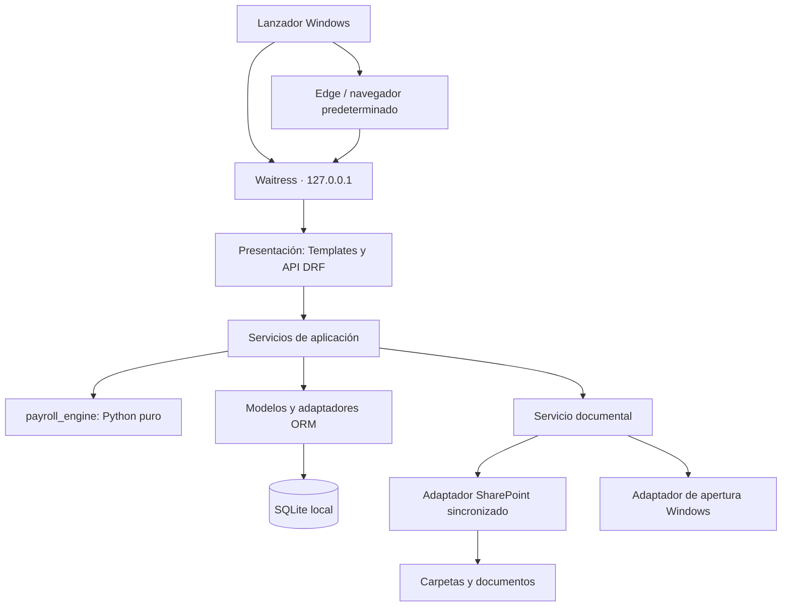

# NóminasRRHH — Arquitectura propuesta y contexto del proyecto

**Estado:** propuesta de arquitectura; pendiente de cerrar las decisiones de negocio indicadas en este documento.  
**Versión del documento:** 0.4.  
**Fecha:** 27 de octubre de 2026.  
**Proyecto:** `Gestion_personal`.  
**Producto propuesto:** `NominasRRHH`.

## Decisiones actualizadas: lectura prioritaria

El **Anexo G** recupera las decisiones acordadas el 26/10/2026 y el **Anexo H** registra el flujo instructivo y el estado comprobado el 27/10/2026. Prevalecen sobre las propuestas iniciales contradictorias, incluidos el prompt reutilizable, el roadmap y el registro inicial de decisiones.

- Producto: simulación, preparación y verificación frente a software oficial de nóminas; no emite los importes definitivos.
- Programa, base de datos, histórico y archivos propios persistentes en el mismo pendrive, sin instalación ni administrador en destino. La propuesta de `%LOCALAPPDATA%` queda sustituida.
- Una usuaria funcional; el propietario realiza mantenimiento técnico sobre el mismo dispositivo.
- El Excel sintético aporta conceptos y escenarios, pero no resultados conciliados ni reglas automáticamente aprobadas.
- Desarrollo instructivo: avanzar paso a paso con el usuario, sin construir toda la aplicación de forma autónoma.
- Entorno de desarrollo actual: Python 3.12.3 y `.venv` operativo. Django y el motor aún no se han creado.

## Cómo utilizar este documento

Este archivo conserva el contexto funcional, las restricciones del entorno, la arquitectura recomendada y las preguntas todavía abiertas. Debe servir como referencia para nuevas conversaciones, para el diseño técnico y para la implementación progresiva.

No es una especificación legal validada ni una declaración de que todas las propuestas hayan sido aprobadas. Distingue tres niveles:

- **Requisito del usuario:** objetivo o restricción expresados por el propietario del proyecto.
- **Propuesta técnica:** recomendación de arquitectura que debe contrastarse durante el desarrollo.
- **Pendiente de confirmar:** regla o decisión que no puede deducirse de la descripción disponible.

Las instrucciones explícitas posteriores del usuario prevalecen sobre las propuestas de este documento. Cuando se acuerde una decisión, debe actualizarse el apartado correspondiente y el registro de decisiones; no debe quedar únicamente en el historial de una conversación.

### Prompt para iniciar una nueva conversación

```text
Trabajamos en el proyecto Gestion_personal / NominasRRHH.

Lee ARQUITECTURA_Y_CONTEXTO.md y las instrucciones aplicables del repositorio
antes de proponer cambios o implementar. Úsalo como contexto del proyecto.

Actúa como arquitecto de software y desarrollador senior especializado en
Python, Django, Django REST Framework, modelado de negocio, nóminas y
aplicaciones portables para Windows.

El objetivo es sustituir progresivamente un Excel de nóminas por una
aplicación mantenible y auditable, con capacidad de crecer hacia RRHH.

Respeta especialmente:
- Distribución Windows autocontenida, sin instalación ni privilegios de administrador.
- Django local en 127.0.0.1, navegador Edge o predeterminado, y SQLite local.
- Programa separado de datos, backups, exportaciones, configuración y logs.
- Motor Python puro independiente de Django y del ORM.
- Decimal, persistencia exacta y redondeos explícitos.
- Condiciones con vigencia y nóminas históricas con entradas y resultados congelados.
- Separación entre devengo, pago, cotización, fiscalidad y prestaciones.
- Documentos en SharePoint sincronizado; la aplicación no almacena sus contenidos.
- Validación de rutas y encapsulación de las operaciones Windows.
- Pruebas de regresión con casos conocidos del Excel.

No conviertas propuestas en decisiones aprobadas ni ejemplos en reglas
generales. Pregunta antes de implementar una regla de negocio ambigua.
No des por auditado el Excel si no has inspeccionado las celdas relevantes.
No desarrolles toda la aplicación de una vez: trabaja en el alcance solicitado
en esta conversación y conserva la separación de responsabilidades.

La instrucción inicial fue diseñar primero la arquitectura. Este documento
no prohíbe implementar después cuando el usuario lo solicite expresamente.

Al terminar una fase, actualiza este archivo si cambian decisiones,
restricciones, preguntas abiertas o estado real del proyecto.

Tarea concreta de esta conversación:
[Indicar aquí el trabajo solicitado.]
```

### Estado inicial al redactar la versión 0.1 (histórico; estado actual en Anexo H)

- El usuario ha solicitado arquitectura y el registro de esa propuesta en Markdown.
- No se ha creado el proyecto Django ni implementado el motor.
- Se ha localizado `RETRIB_OFICINA_2026_ANONIMIZADO_DATOS_SINTETICOS.xlsx` en la raíz del repositorio.
- El contenido de sus celdas, fórmulas y resultados todavía no se ha auditado.
- La arquitectura parte de la descripción funcional proporcionada por el usuario.
- Las preguntas sobre IRPF, significado de tramos y tratamiento de seguros/pagas extra siguen abiertas.
- Los fragmentos de código y esquemas siguientes son ilustrativos; no representan funcionalidad implementada.

## 1. Propósito y arquitectura general

### 1.1. Objetivo del producto

Construir una aplicación interna de RRHH cuyo primer módulo serio sea el cálculo de nóminas. Debe sustituir progresivamente al Excel que el usuario ha construido durante 2026.

El Excel se considera simultáneamente:

1. Prototipo funcional.
2. Fuente inicial de reglas de negocio.
3. Fuente de casos de prueba.
4. Herramienta de validación durante la transición.

El objetivo no es traducir literalmente fórmulas a vistas Django. Se busca extraer la lógica, modelar el dominio, implementar cálculos testeables y conservar su explicación.

Tras la migración, SQLite y la aplicación conservarán los datos y resultados de las simulaciones. Las nóminas definitivas seguirán procediendo del software oficial externo.

### 1.2. Restricciones obligatorias del equipo corporativo

En el equipo de producción Windows:

- No hay credenciales de administrador.
- No se puede depender de instalaciones que requieran elevación.
- No se puede asumir Python instalado.
- No se pueden exigir PostgreSQL, Node ni runtimes instalados manualmente.
- No se deben modificar servicios ni variables de entorno globales.
- No se depende de instaladores MSI/EXE.
- La aplicación debe funcionar sin conexión obligatoria a Internet.
- Las políticas corporativas de seguridad deben respetarse.

La experiencia prevista es: copiar una carpeta, ejecutar `NominasRRHH.exe` y trabajar. Un instalador solo se valorará si IT lo solicita en el futuro.

El desarrollo y la construcción de la distribución se realizarán en un equipo que sí disponga de herramientas de desarrollo.

### 1.3. Arquitectura recomendada

Un **monolito modular**, desplegado como aplicación portable, con estas piezas:

| Pieza | Responsabilidad |
|---|---|
| Aplicación Django | Interfaz, formularios, API, persistencia y coordinación de casos de uso |
| `payroll_engine` | Cálculos puros, reglas de negocio, controles y explicación de resultados |
| Infraestructura | Almacenamiento, Excel, archivos, backups y operaciones Windows |
| Lanzador de escritorio | Instancia única, compatibilidad, migraciones, servidor, navegador y cierre |

Tecnologías propuestas:

| Área | Elección |
|---|---|
| Lenguaje | Python |
| Backend | Django |
| API | Django REST Framework |
| Interfaz | Django Templates, HTML y Bootstrap local |
| JavaScript | Solo para interacciones que lo requieran |
| Base de datos inicial | SQLite en disco local |
| Servidor WSGI local | Waitress |
| Estáticos | WhiteNoise y recursos incluidos en la distribución |
| Interfaz de escritorio | Edge en modo aplicación, con alternativa en navegador predeterminado |
| Empaquetado | PyInstaller, preferentemente `--onedir` |
| Evolución multiusuario | PostgreSQL y despliegue central, cuando el uso lo justifique |

Como base inicial se propone Python 3.13 y Django 5.2 LTS. Las versiones concretas de mantenimiento, DRF, Waitress y PyInstaller deben fijarse y probarse juntas al preparar el proyecto. No se deben interpretar estas versiones como una obligación de conservar paquetes obsoletos.

Django 5.2 admite Python 3.13 y tiene soporte extendido previsto hasta abril de 2028. Waitress funciona en Windows y está implementado en Python. Referencias: [Django 5.2](https://docs.djangoproject.com/en/5.2/releases/5.2/), [soporte de Django](https://www.djangoproject.com/download/), [Waitress](https://docs.pylonsproject.org/projects/waitress/en/stable/).

No se propone React, Vue, Angular, Electron ni una SPA. Tampoco PyWebView como dependencia inicial, para evitar que la solución dependa de disponer de WebView2 Runtime.

## 2. Diagrama conceptual de capas



Las flechas representan invocaciones y dependencias entre componentes. El motor matemático no importa Django, el ORM, los adaptadores Windows ni los servicios de archivos.

La organización debe separar:

- Dominio y reglas.
- Modelos persistidos.
- Servicios de aplicación.
- Configuración normativa.
- Presentación y API.
- Informes.
- Infraestructura del puesto.

No es necesario introducir una interfaz abstracta para cada objeto. Las abstracciones se justifican donde existe una dependencia externa o una sustitución prevista: documentos, apertura Windows y ciertos servicios de infraestructura.

## 3. Apps Django propuestas

Se recomienda comenzar con seis apps:

| App | Contenido |
|---|---|
| `empleados` | Empresa, trabajadores, contratos, condiciones retributivas y fiscales |
| `nominas` | Periodos, variables, situaciones NCM, nóminas, revisiones y bonus |
| `normativa` | Configuraciones de SS y fiscalidad, vigencias, fuentes y revisiones |
| `documentos` | Asociaciones documentales, consultas y acciones |
| `informes` | Resúmenes, consultas y exportaciones |
| `configuracion` | Preferencias funcionales, configuración del puesto y diagnóstico |

`ncm`, `bonus` y `seguridad_social` comenzarían como módulos internos de `nominas` y del motor. Se convertirían en apps independientes si adquiriesen procesos, permisos o mantenimiento suficientemente autónomos.

Una app Django es una frontera de organización del producto, no necesariamente un calculador ni una opción del menú.

El menú funcional solicitado se mantiene:

```text
Dashboard
Trabajadores
Nóminas
Variables mensuales
Bonus
Documentos
Seguridad Social
Informes
Configuración
```

La ficha del trabajador contempla:

```text
Datos · Contrato · Retribución · Variables · Nóminas
NCM · Bonus · Documentos · Resumen anual · Histórico
```

## 4. Componentes fuera de las apps Django

| Paquete | Responsabilidad |
|---|---|
| `payroll_engine/` | Tipos, reglas, calculadores, resultados, controles y trazas |
| `desktop/` | Arranque y ciclo de vida del ejecutable |
| `infrastructure/windows/` | Edge, Explorador, apertura de archivos y selección de carpetas |
| `infrastructure/database/` | Backups, comprobaciones, actualización y recuperación |
| `infrastructure/documents/` | Implementaciones del almacenamiento documental |
| `infrastructure/excel/` | Lectura del libro y adaptación de datos |

Los servicios de aplicación pueden vivir en `apps/nominas/services/` y utilizar el ORM directamente. No se propone construir repositorios genéricos para cada modelo.

No se introducirán inicialmente microservicios, Redis, Celery, un bus de eventos ni un lenguaje dinámico de fórmulas. El motor tendrá reglas identificadas implementadas en Python; no ejecutará expresiones arbitrarias guardadas en la base de datos.

Conviene evitar un `core/` que se convierta en contenedor de cualquier código compartido. Los elementos compartidos deben tener una responsabilidad concreta.

## 5. Modelo de dominio inicial

### 5.1. Unidades principales

- **Trabajador:** identidad de la persona y vinculación con la organización.
- **Relación laboral:** contrato y condiciones aplicables en cada intervalo.
- **Entrada mensual:** variables, tramos e incidencias utilizadas en una liquidación.
- **Nómina:** identidad de una liquidación y conjunto de revisiones conservadas.
- **Configuración normativa:** parámetros y reglas aplicables en una fecha y un supuesto.
- **Bonus y regularización:** reconocimiento, pago e imputación a periodos anteriores.
- **Ubicación documental:** referencia a una carpeta cuyos documentos permanecen en SharePoint.

Se recomienda incorporar `Empresa` desde el inicio, aunque exista una sola, y una referencia al código de cuenta de cotización cuando sea necesaria.

### 5.2. Vocabulario que debe mantenerse diferenciado

| Concepto | Significado |
|---|---|
| Devengo | Derecho generado durante un periodo |
| Pago | Importe satisfecho en una fecha |
| Imputación para cotización | Periodo al que corresponde una remuneración a efectos de SS |
| Base fiscal | Magnitud a la que corresponde un tratamiento fiscal |
| Base de cotización | Magnitud computable para un concepto de SS, antes o después de sus límites según se identifique |
| Prorrata de extras para SS | Imputación a cotización de las extras; no implica pago mensual |
| Prestación | Importe de una prestación, con su pagador identificado |
| Líquido pagado por empresa | Importe monetario que resulta a cargo de la empresa tras las deducciones aplicables |
| Coste empresa | Coste calculado según una definición explícita y conciliable |
| Equivalente a 12 pagas | Magnitud comparativa cuya definición debe documentarse; no sustituye los pagos reales |

No se debe utilizar `bruto` como nombre ambiguo para varias magnitudes diferentes.

### 5.3. Invariantes iniciales

- No sobrescribir importes históricos para reflejar un cambio futuro.
- No modificar una nómina confirmada para regularizar un bonus.
- No recalcular históricos con condiciones actuales al consultarlos.
- No convertir datos necesarios ausentes en ceros silenciosos.
- No admitir periodos o situaciones incompatibles sin un error explícito.
- No confundir una simulación con una nómina confirmada o con una cotización efectivamente liquidada.

## 6. Modelo de datos Django inicial

El esquema siguiente es una propuesta lógica. No se deben crear todas las tablas de una vez sin necesidad funcional.

| Modelo | Campos o relaciones esenciales |
|---|---|
| `Empresa` | Identificación, denominación y datos de cabecera |
| `CuentaCotizacion` | Empresa, código y datos necesarios para cotización |
| `Trabajador` | Código interno, nombre, identificación y nacimiento |
| `ContratoLaboral` | Trabajador, empresa, inicio y fin de la relación contractual |
| `CondicionContractual` | Contrato, vigencia, modalidad, jornada, grupo y referencia AT/EP |
| `CondicionRetributiva` | Contrato, vigencia y política retributiva |
| `ConceptoRetributivo` | Código, descripción y tratamiento versionado |
| `ImporteConcepto` | Condición, concepto, importe y unidad |
| `CondicionFiscalTrabajador` | Vigencia, porcentaje si es manual y procedencia |
| `PoliticaPagasExtra` | Periodos de devengo, fechas de pago y reglas de inclusión |
| `PeriodoNomina` | Empresa, año, mes y estado de cierre |
| `VariableMensual` | Contrato, periodo, revisión y observaciones |
| `TramoMensual` | Variable, fechas, unidades computables, porcentaje y situación |
| `VariableConcepto` | Variable mensual, concepto e importe excepcional |
| `SituacionNCM` | Trabajador, fechas, bases de referencia y procedencia |
| `Nomina` | Contrato, periodo, clase de liquidación y revisión vigente |
| `RevisionNomina` | Número, estado, entradas, resultados, versiones y trazabilidad |
| `LineaNomina` | Revisión, concepto, devengo, pago, deducción y tratamiento |
| `CuotaSeguridadSocial` | Revisión, concepto, segmento, base, tipo, importe y responsable |
| `ConfiguracionSeguridadSocial` | Ejercicio, vigencia, revisión, estado y fuente |
| `TipoCotizacion` | Configuración, concepto, condiciones de aplicación y tipos |
| `LimiteCotizacion` | Configuración, grupo o supuesto y límites |
| `TramoSolidaridad` | Configuración, orden, límites y tipos de empresa/trabajador |
| `ConfiguracionFiscal` | Vigencia, versión del algoritmo o política y fuente |
| `BonusAnual` | Trabajador, ejercicio de devengo, importe y fecha prevista/real de pago |
| `RegularizacionBonus` | Bonus, revisión, estado y referencias utilizadas |
| `RegularizacionBonusMensual` | Mes, referencia histórica, reparto y diferencias |
| `CarpetaDocumentalTrabajador` | Trabajador y ruta relativa |
| `EventoAuditoria` | Actor, acción, entidad, fecha y motivo |
| `LoteImportacion` | Origen, huella del archivo, fecha, estado y errores |

### 6.1. Decisiones de persistencia

- Las tablas relacionales contendrán los datos que se editan, relacionan y consultan habitualmente.
- Las instantáneas de entradas, resultados y trazas podrán almacenarse como JSON versionado, con decimales representados como texto.
- Un identificador de condición no basta para reproducir un cálculo si esa condición puede corregirse: se conservará también el valor utilizado.
- Las restricciones simples se expresarán en base de datos: unicidad, rangos válidos y relaciones obligatorias.
- Los solapamientos y coherencia entre varias filas se validarán en los servicios, dentro de la estrategia de escritura acordada.
- Las relaciones históricas relevantes se protegerán frente a borrados en cascada.
- La baja de un trabajador no eliminará sus nóminas, contratos ni regularizaciones.

No se crearía inicialmente `CalculoSeguridadSocial` si solo envuelve una colección de cuotas. Las bases pueden formar parte del resultado estructurado de la revisión y las cuotas tener sus propias filas.

No se utilizaría `HistoricoCalculo` como tabla genérica para mezclar ejecuciones matemáticas, modificaciones administrativas y errores técnicos. Sus propósitos y conservación son diferentes.

Los estados y claves exactos de unicidad de nóminas deben permitir ordinarias, extras y, si se incorporan, liquidaciones complementarias. No basta con imponer una única nómina por trabajador y mes para todos los casos.

## 7. Histórico temporal y configuración normativa

### 7.1. Entidades con vigencia

Necesitan histórico:

- Jornada y condiciones contractuales.
- Salarios, antigüedad retributiva, complementos y seguros.
- Porcentaje o condiciones de retención.
- Grupo de cotización y clasificación AT/EP.
- Políticas de pagas extraordinarias.
- Configuraciones legales.
- Situaciones NCM.

Se propone usar intervalos `[desde, hasta)`: inicio incluido y fin excluido.

```text
Desde 01/01/2026 hasta 01/07/2026: 3.000 €
Desde 01/07/2026 sin fecha final: 3.300 €
```

Debe registrarse además cuándo se conoció o introdujo un cambio y su motivo. Una condición puede ser efectiva desde enero y registrarse en marzo.

No se plantea inicialmente un sistema bitemporal completo. Las vigencias, revisiones, eventos e instantáneas de cálculo cubren el problema principal con menos complejidad.

### 7.2. Parámetros legales por ejercicio, vigencia y revisión

El año no es suficiente para identificar una configuración. La estructura debe admitir:

```text
Ejercicio
Vigente desde / hasta
Revisión
Estado: borrador o validada, según el flujo acordado
Fuente normativa
Fecha de incorporación
Responsable o procedencia de validación
```

Pueden producirse cambios dentro del año y publicaciones con efectos anteriores a la fecha en que se conocen.

Los parámetros de cotización incluirán los necesarios para el ámbito aprobado: tipos de CC, desempleo, FOGASA, FP, MEI y AT/EP; mínimos y máximos; condiciones contractuales; límites y tipos de solidaridad; y parámetros específicos de situaciones especiales.

Número de pagas, conceptos que generan extras y políticas empresariales sobre seguros no deben confundirse con normativa de Seguridad Social.

Una modificación de porcentajes puede resolverse mediante datos. Una modificación de la estructura de una regla puede requerir una nueva versión del motor. No se promete resolver cualquier cambio legislativo editando una tabla.

Las configuraciones utilizadas en nóminas confirmadas deben conservarse. Una corrección genera una revisión identificada; no sustituye silenciosamente los valores históricos.

## 8. Diseño del motor de cálculo

Se propone crear `payroll_engine` como paquete Python puro dentro del mismo repositorio.

### 8.1. Entrada

```python
resultado = calcular_nomina(
    entrada=EntradaNomina(
        periodo=periodo,
        segmentos=segmentos,
        conceptos=conceptos,
        situaciones=situaciones,
        configuraciones=configuraciones,
        politica_redondeo=politica_redondeo,
    )
)
```

Los DTO serán explícitos y preferentemente inmutables. No contendrán modelos ORM ni referencias que obliguen al motor a consultar datos externos.

Los segmentos permiten representar cambios dentro del mes: salario, jornada, situación, condiciones contractuales o normativa aplicable.

La función recibe todas las entradas necesarias. No depende de la fecha actual implícita, de variables globales mutables ni del usuario conectado.

### 8.2. Resultado

```text
ResultadoNomina
├── devengos
├── pagos
├── retribucion_en_especie
├── pagas_extra
├── bases_cotizacion
├── cuotas_trabajador
├── cuotas_empresa
├── resultado_fiscal
├── prestaciones
├── liquido_empresa
├── coste_empresa
├── controles
└── traza
```

La secuencia de cálculo será visible y estable:

1. Validar entradas y cobertura del periodo.
2. Resolver segmentos y unidades de cálculo.
3. Calcular conceptos retributivos y efectos de situaciones.
4. Determinar devengo y tratamiento de extras.
5. Construir bases de cotización y aplicar límites.
6. Calcular cuotas y solidaridad.
7. Calcular el resultado fiscal del alcance aprobado.
8. Obtener pagos, deducciones y costes.
9. Conciliar resultados y devolver controles y traza.

Las clases de calculador son útiles si agrupan reglas y dependencias claras. No es necesario convertir cada operación aritmética en una clase.

## 9. Separación entre Django y el motor

El servicio de aplicación seguirá este flujo:

```text
ORM
  ↓
Selección de vigencias, revisiones y datos necesarios
  ↓
DTO de entrada
  ↓
payroll_engine
  ↓
Resultado estructurado
  ↓
Validación de que las entradas siguen siendo las mismas
  ↓
Persistencia transaccional de la revisión completa
```

El cálculo se ejecutará fuera de una transacción de escritura prolongada. Antes de guardar o confirmar se comprobará que las entradas no han cambiado; en caso contrario se solicitará recalcular.

Templates y DRF llamarán a los mismos servicios. Una vista de Templates no debe invocar por HTTP la API de la propia aplicación para reutilizar lógica.

Los informes sobre nóminas confirmadas leerán sus resultados persistidos. Consultar un histórico no debe activar un recálculo con reglas nuevas.

No se harán cálculos monetarios de negocio en JavaScript. La interfaz recibirá representaciones exactas y resultados del backend.

## 10. Diseño de los cálculos funcionales

### 10.1. Nómina y conceptos

Cada concepto debe declarar su naturaleza y tratamiento: pago dinerario, especie, deducción, inclusión en bases, tratamiento fiscal y participación en extras.

Unos booleanos pueden cubrir conceptos sencillos, pero no sustituyen reglas con límites, exenciones, condiciones o vigencias. Se evitará modelar toda la normativa como `cotiza=True` y `tributa=True`.

La **gratificación voluntaria excepcional**, según la regla expresamente aportada por el usuario:

- Tributa en IRPF.
- Cotiza.
- Suma a la base de SS según las reglas de bases y topes aplicables.
- No genera paga extraordinaria.

Los ajustes deben tener concepto, motivo y tratamiento. No se asumirá que cualquier ajuste afecta por igual a bruto, bases y pago.

### 10.2. Modelo de 14 pagas

La empresa trabaja normalmente con doce nóminas ordinarias y dos pagas extraordinarias.

El sistema distinguirá:

- Devengo de cada extra y periodo que lo genera.
- Fecha y cuantía de pago.
- Prorrata para Seguridad Social.
- Tratamiento fiscal del pago.
- Conceptos incluidos o excluidos.
- Efectos de cambios retributivos, jornada y NCM.

La prorrata para SS no se sumará automáticamente al pago mensual. El equivalente a doce pagas será una magnitud identificada, no una sustitución del calendario real.

Quedan por confirmar el devengo anual o semestral, los conceptos incluidos y el criterio ante modificaciones salariales durante el periodo de devengo.

### 10.3. Seguridad Social

El calculador distinguirá bases y reglas por contingencia y situación. No se asumirá que CC, contingencias profesionales y los restantes conceptos utilizan siempre una base intercambiable.

Debe contemplar, dentro del ámbito aprobado:

- Remuneraciones computables.
- Prorrata de extras.
- Ajustes con tratamiento conocido.
- Componentes asociados a NCM.
- Mínimos y máximos.
- Tipos dependientes del supuesto contractual o profesional.
- Desglose de cuotas de trabajador y empresa.
- Responsable de cada cuota y deducción efectiva en nómina cuando no coincidan.

El orden de aplicación de bases, segmentaciones y topes debe documentarse y probarse. No se inventará a partir de los nombres de columnas.

### 10.4. Nacimiento y Cuidado del Menor

`NCMCalculator` encapsulará:

- Parte trabajada y parte de descanso.
- Bases de referencia y su procedencia.
- Bases resultantes y límites aplicables.
- Prestación y pagador.
- Cuotas vinculadas a cada componente.
- Efectos sobre seguros y conceptos retributivos.
- Efectos sobre devengo y pago de extras.

Se diferenciarán jornada contratada, fracción trabajada durante NCM, días naturales y unidades utilizadas para salario y cotización.

El ejemplo `28 días al 75 % + 2 días al 100 %` se conservará como caso pendiente de precisar semánticamente. No está confirmado si el porcentaje se refiere siempre a la jornada contratada ni si su complemento representa necesariamente NCM.

La normativa de cotización de 2026 contempla componentes diferenciados para descanso y trabajo en NCM parcial. Esto respalda la separación del diseño, pero no valida automáticamente las fórmulas del Excel sobre topes, seguros o extras. Referencia: [Orden PJC/297/2026, artículo 6](https://www.boe.es/buscar/act.php?id=BOE-A-2026-7296).

La prestación NCM y el líquido pagado por la empresa permanecerán separados. Su suma podrá mostrarse en un informe si se identifica claramente qué representa.

### 10.5. Tramos mensuales

El Excel permite hasta cuatro tramos y exige que sus días sumen 30. Se conservará este comportamiento allí donde se confirme que corresponde.

El dominio admitirá una colección de tramos, sin codificar campos `T1`, `T2`, `T3` y `T4` en el motor. La interfaz puede presentar inicialmente cuatro filas si facilita la transición.

La conversión entre fechas reales, días salariales, cotización y fracciones de jornada será una regla explícita. Altas/bajas parciales, febrero y meses de 31 días no se resolverán suponiendo que toda situación suma 30.

La jornada equivalente puede ser un resultado útil, pero no sustituirá los tramos cuando una regla necesite aplicarse por segmento.

### 10.6. Solidaridad

Los tramos se obtendrán de la configuración aplicable. Para límites absolutos ya resueltos, la forma general de la base de un tramo es:

```text
base_tramo = max(0, min(remuneracion_computable, limite_superior)
                   - limite_inferior)
```

El último tramo podrá carecer de límite superior. Los límites pueden derivarse de parámetros configurados, pero su interpretación debe estar documentada.

Cada tramo devolverá:

- Base.
- Tipo de trabajador.
- Cuota de trabajador.
- Tipo de empresa.
- Cuota de empresa.

Se calcularán `solidaridad_trabajador_total` y `solidaridad_empresa_total` a partir de las cuotas correspondientes.

Quedan por validar la remuneración computable y la interacción con NCM, límites, extras y bonus. La fórmula genérica no resuelve esas decisiones.

### 10.7. Bonus y regularización

Se distinguen tres hechos:

1. Cuándo se devenga el bonus.
2. Cuándo se paga.
3. A qué meses se imputa para recalcular cotización.

El comportamiento solicitado es simular el reparto del bonus anual entre las doce ordinarias, excluyendo las extras. El ejemplo aportado es un bonus anual de 30.000 € y un reparto mensual de 2.500 €.

Esta política no se extenderá sin confirmación a altas, bajas, ejercicios incompletos, periodos NCM o meses sin nómina ordinaria.

Por cada mes se conservarán:

- Referencia histórica utilizada.
- Importe de bonus imputado.
- Bases y cuotas de la referencia.
- Bases y cuotas recalculadas con bonus.
- Bases y cuotas de cada tramo de solidaridad.
- Diferencia de trabajador, empresa y total.
- Relación con regularizaciones anteriores, si existen.

`Nomina` y `RegularizacionBonus` son entidades diferentes. La regularización no modifica el cálculo original.

Debe distinguirse la cotización calculada en nómina de la efectivamente liquidada. Si no existe conciliación, la primera no debe presentarse como prueba de lo ingresado realmente.

Una segunda regularización no puede reclamar otra vez diferencias ya regularizadas. Las diferencias negativas no se convertirán automáticamente en cero: su tratamiento requiere una regla acordada.

El pago del bonus y su efecto fiscal se modelarán separadamente de la imputación para SS. No se distribuirá automáticamente su fiscalidad entre doce meses por el hecho de hacerlo con la cotización.

### 10.8. IRPF

Hay dos alcances posibles, todavía pendientes de decisión:

- Aplicar un porcentaje conocido por trabajador, con histórico de vigencia.
- Calcular además el porcentaje y sus regularizaciones mediante el algoritmo correspondiente.

El segundo requiere entradas fiscales específicas, reglas, versiones y una batería de pruebas propia. No se reduce a una tabla anual de porcentajes.

La documentación y algoritmos oficiales de la AEAT son la referencia para definir ese alcance: [Retenciones de la AEAT](https://sede.agenciatributaria.gob.es/Sede/Retenciones.shtml).

No se ha elegido implícitamente ninguna de las dos opciones.

## 11. Auditabilidad y conservación de resultados

Cada revisión persistida conservará:

- Entradas exactas utilizadas.
- Referencias a contratos, condiciones y variables.
- Copia de los parámetros normativos aplicados.
- Versiones de aplicación, motor y formato de resultado.
- Política de redondeo.
- Resultados intermedios y finales.
- Controles y advertencias de negocio.
- Autor o identidad operativa, fecha, motivo y procedencia.
- Huella del contenido para comprobar integridad.

Una traza de paso tendrá, conceptualmente:

```text
Identificador de regla: SS.CC.TRABAJADOR
Descripción
Entradas y unidades
Operación aplicada
Resultado previo al redondeo
Política de redondeo
Resultado final
Referencias a pasos anteriores
Fuente o versión de la regla
```

La interfaz permitirá navegar desde el total a sus componentes y después al detalle. Se mantendrá la secuencia auditable que actualmente proporciona el Excel.

### 11.1. Desgloses mínimos solicitados

```text
Bruto
    sueldo base
    antigüedad
    seguros
    complementos
    gratificaciones

Base SS
    remuneración
    extras
    ajustes
    NCM
    topes

SS trabajador
    CC
    desempleo
    FP
    MEI
    solidaridad

SS empresa
    CC
    desempleo
    FOGASA
    FP
    MEI
    AT/EP
    solidaridad
```

Los nombres definitivos deben reflejar los conceptos reales, especialmente cuando los seguros sean especie, descuentos o costes adicionales.

### 11.2. Revisiones y límites de la auditoría local

Una nómina confirmada será inmutable a través de los servicios de aplicación. Una corrección generará otra revisión vinculada a la anterior y un motivo.

La huella de contenido ayuda a detectar alteraciones accidentales; no protege por sí sola frente a quien controle el archivo SQLite y pueda modificar también las huellas.

Para reproducir un cálculo antiguo no basta con conservar los datos: debe poder identificarse y recuperarse la versión del código que aplicó las reglas. Se archivarán las distribuciones y fuentes necesarias según la política del proyecto.

La auditoría de negocio se almacena con los datos. Los errores de ejecución y diagnóstico van al log técnico; no se mezclan ambas funciones.

## 12. Precisión, Decimal y redondeos

### 12.1. Cálculo exacto

Todas las operaciones económicas del motor utilizarán `Decimal`, construido desde texto o enteros. No se creará dinero mediante `Decimal(float)` ni se realizarán pasos intermedios monetarios con `float`.

Se propone un contexto explícito por ejecución con precisión inicial de 28 dígitos y detección de mezclas indebidas. Referencia: [Decimal en Python](https://docs.python.org/3/library/decimal.html).

La precisión interna es distinta del número de decimales mostrados al usuario. Una base diaria puede requerir más precisión que un importe final pagado.

### 12.2. Persistencia con SQLite

`DecimalField` sobre SQLite no garantiza aritmética decimal exacta en la base. Django documenta la conversión interna a representación de coma flotante: [tratamiento de decimales en SQLite](https://docs.djangoproject.com/en/5.2/ref/databases/#decimal-handling).

La propuesta para respetar el requisito de exactitud es:

| Dato | Representación |
|---|---|
| Importes finales | Enteros de céntimos |
| Importes que requieren más precisión | Enteros con escala fija documentada |
| Tipos y coeficientes | Enteros con escala fija suficiente |
| Instantáneas y trazas JSON | Decimales como cadenas |
| Operaciones del motor | `Decimal` |

Las escalas concretas se fijarán después de inventariar las precisiones necesarias. No se redondeará una base diaria a céntimos solo para almacenarla.

Los adaptadores harán las conversiones. Formularios e informes trabajarán en euros y porcentajes. No es necesario desarrollar un framework de campos monetarios.

La API transmitirá valores monetarios como cadenas decimales o como enteros con unidad documentada. El frontend no debe convertirlos a números binarios para recalcular nóminas.

### 12.3. Política de redondeo pendiente de validar

`ROUND_HALF_UP` es una propuesta a contrastar, no una regla ya aprobada del Excel.

Debe documentarse:

- Precisión de cada entrada.
- Precisión de operaciones intermedias.
- Momento de redondeo por concepto, tramo, cuota, mes y acumulado.
- Si el total suma cuotas ya redondeadas o redondea una suma previa.
- Tratamiento de importes negativos.
- Asignación de restos al repartir importes.

Los totales mostrados deben conciliar con sus componentes guardados. Las diferencias de céntimos tendrán una explicación y, cuando proceda, una línea o dato de ajuste explícito.

No se aceptará una tolerancia genérica que oculte diferencias de regresión sin analizarlas.

## 13. Estrategia de pruebas

### 13.1. Grupos de pruebas

| Grupo | Qué verifica |
|---|---|
| Motor puro | Fórmulas, límites, conceptos, NCM, extras, solidaridad y bonus sin Django |
| Regresión Excel | Entradas congeladas y resultados conocidos por componente |
| Aplicación Django | Vigencias, revisiones, cierres, restricciones, transacciones e importaciones |
| Documentos | Rutas, aislamiento, archivos inexistentes, permisos y navegación |
| Distribución Windows | Arranque, instancia única, cierre, actualización y recuperación |

### 13.2. Casos funcionales solicitados

```text
test_nomina_normal
test_base_maxima
test_solidaridad_t1
test_solidaridad_t2
test_solidaridad_t3
test_ncm_parcial
test_ncm_multitramo
test_bonus_sin_tope
test_bonus_supera_base_maxima
test_bonus_solidaridad
test_gratificacion_excepcional
```

Se añadirán casos para:

- Un céntimo por debajo, exactamente en y por encima de los límites.
- Cambio salarial o normativo dentro del mes.
- Meses incompletos, febrero y meses de 31 días.
- NCM que atraviesa varios meses o condiciones.
- Retribución en especie.
- Bonus regularizado parcialmente con anterioridad.
- Importes negativos cuando el ámbito los permita.
- Configuración obligatoria ausente.
- Conservación de totales al repartir y acumular.
- Recalcular sin alterar la revisión confirmada.
- Intentos de confirmar con entradas modificadas desde el cálculo.
- Importación repetida y recuperación tras un error.

### 13.3. Casos documentales solicitados

```text
test_no_permite_salir_sharepoint_root
test_listar_documentos
test_ruta_trabajador
test_path_traversal
test_archivo_inexistente
```

También se comprobarán rutas absolutas manipuladas, otras unidades, separadores Windows, accesos a otra carpeta de trabajador, junctions y enlaces que escapen del ámbito autorizado, extensiones no admitidas y errores de acceso.

Los casos específicos de Windows y OneDrive se ejecutarán además en un entorno representativo. Un sistema de archivos temporal de pruebas no reproduce todos sus comportamientos.

### 13.4. Regresión frente al Excel

Cada caso tendrá:

- Identificador estable y descripción.
- Entradas completas.
- Hoja y celdas de procedencia.
- Configuración aplicable.
- Resultados esperados por concepto, base y cuota.
- Estado de revisión y explicación de excepciones.

La comparación no se limitará al neto: dos errores pueden compensarse en el total.

Un desacuerdo puede proceder del motor, del Excel o de una diferencia de criterio. No se dará siempre la razón al Excel ni se corregirá el motor sin registrar el motivo.

Los fixtures del repositorio deben utilizar datos sintéticos o anonimizados. Los resultados importados de un libro no se declararán validados únicamente porque estén presentes en una celda.

### 13.5. Pruebas operativas imprescindibles

- Ejecutar el paquete en Windows sin Python, Node ni herramientas de desarrollo.
- Trabajar con usuario estándar y sin Internet.
- Intentar abrir dos instancias.
- Abrir varias ventanas de la interfaz.
- Probar el navegador alternativo.
- Cerrar durante una operación y verificar el comportamiento previsto.
- Restaurar un backup.
- Actualizar desde la versión anterior.
- Simular una migración fallida, falta de espacio y archivo bloqueado.
- Verificar una ruta de recuperación tras una actualización interrumpida.

La ejecución del motor puro no requerirá configurar `DJANGO_SETTINGS_MODULE` ni levantar un servidor.

## 14. Gestión documental inicial

### 14.1. Alcance

SharePoint seguirá siendo el repositorio documental. La aplicación ofrece una interfaz sobre una biblioteca sincronizada localmente mediante OneDrive.

Ejemplo de configuración:

```text
Raíz del puesto:
C:\Users\usuario\Empresa\RRHH

Ruta relativa del trabajador:
Trabajadores\Xiana Gonzalez
```

Se guardará la raíz una vez por puesto y la ruta relativa en la asociación del trabajador. No se almacenarán rutas absolutas completas por trabajador.

Si se crean carpetas nuevas en una fase futura, puede valorarse un código interno estable en el nombre para reducir el impacto de cambios de nombre. No se renombrarán automáticamente carpetas existentes sin una operación explícita.

### 14.2. Funcionalidad

En la ficha del trabajador, la sección Documentos permitirá:

- Consultar carpetas y subcarpetas.
- Ver nombre y extensión.
- Ver tamaño lógico cuando esté disponible.
- Ver fecha de modificación.
- Navegar dentro del ámbito autorizado.
- Abrir un documento con su aplicación predeterminada.
- Abrir una carpeta.
- Mostrar un archivo seleccionado en el Explorador.

La apertura se realizará desde el backend local a través del adaptador Windows. No se intentará lanzar aplicaciones directamente desde JavaScript ni se dependerá de enlaces `file://`.

La enumeración se hará por directorio y bajo demanda. No se recorrerá toda la biblioteca al iniciar la aplicación.

No se exige previsualización de documentos dentro de la interfaz, clasificación automática, versionado documental propio ni motor de búsqueda sobre contenidos.

### 14.3. Files On-Demand

La aplicación podrá listar los metadatos disponibles e intentar la apertura. OneDrive y Windows gestionarán la descarga cuando corresponda.

No se desarrollará sincronización propia ni se forzará la descarga de toda la biblioteca. El tamaño lógico de un archivo no se confundirá con su ocupación local.

Sin conexión, un documento disponible solo en nube puede no abrirse. La aplicación explicará ese resultado sin atribuirse capacidad de sincronización que no tiene.

### 14.4. Errores de usuario diferenciados

- Raíz no configurada.
- Raíz inexistente o no accesible.
- Carpeta de trabajador inexistente.
- Archivo que ha desaparecido desde el listado.
- Acceso denegado.
- Fallo al solicitar la apertura.
- Problema de disponibilidad de un documento en nube.

## 15. Abstracción para SharePoint sincronizado

Se recomienda separar almacenamiento y apertura local:

```text
DocumentStorage
    listar_directorio()
    obtener_metadatos()
    resolver_referencia()

DocumentOpener
    abrir_documento()
    abrir_carpeta()
    mostrar_en_explorador()
```

`DocumentStorageService` coordinará los casos de uso, incluida la consulta de documentos de un trabajador.

Implementaciones iniciales:

- `LocalSharePointStorage` para el árbol sincronizado.
- `WindowsDocumentOpener` para las acciones del sistema operativo.

Los consumidores recibirán DTO con nombres, referencias y metadatos; no dependerán de `pathlib`, `os`, `subprocess` ni de procesos Windows.

En una evolución posterior, `SharePointGraphStorage` podrá utilizar identificadores y enlaces del repositorio remoto. No se implementará ahora un adaptador vacío ni una integración Graph sin necesidad.

**Límite importante de la evolución a servidor:** si el backend se centraliza, abrir un archivo desde ese backend lo abriría en el servidor, no en el puesto del usuario. Será necesario adaptar las acciones a enlaces de SharePoint o a un componente local. La separación propuesta facilita ese cambio, pero no elimina la diferencia de comportamiento.

## 16. Seguridad de rutas y acciones documentales

### 16.1. Ámbitos autorizados

Toda operación debe permanecer dentro de la raíz configurada. Las operaciones de una ficha deben quedar además dentro de la carpeta del trabajador correspondiente.

El cliente no puede convertir una petición de la ficha de una persona en acceso a otra carpeta simplemente modificando una ruta.

### 16.2. Validación centralizada

Secuencia propuesta:

1. Obtener la raíz configurada desde una fuente confiable.
2. Validar la asociación relativa del trabajador.
3. Validar la subruta solicitada.
4. Rechazar rutas absolutas, unidades y rutas UNC aportadas por el cliente.
5. Rechazar namespaces de dispositivo, componentes de escape y formas no admitidas.
6. Resolver la ubicación efectiva.
7. Comprobar pertenencia por componentes a la raíz y a la carpeta autorizada.
8. Comprobar el tipo de objeto y la acción solicitada.
9. Revalidar inmediatamente antes de la apertura.

La comprobación no utilizará prefijos de texto como `startswith()`: una carpeta de nombre parecido no es una descendiente autorizada.

La normalización de entradas y su decodificación deben ser coherentes entre la capa HTTP y el servicio; no se introducirán decodificaciones repetidas que transformen posteriormente una entrada validada.

### 16.3. Enlaces, junctions y archivos de nube

Los enlaces simbólicos y junctions pueden redirigir fuera de la raíz aunque la ruta escrita parezca estar dentro.

Windows ofrece mecanismos para obtener la ruta final de un objeto a partir de un identificador. Referencia: [GetFinalPathNameByHandleW](https://learn.microsoft.com/en-us/windows/win32/api/fileapi/nf-fileapi-getfinalpathnamebyhandlew).

No se rechazarán indiscriminadamente todos los reparse points, porque los marcadores de archivos de nube pueden utilizarlos. Se distinguirán redirecciones y placeholders. Referencias: [reparse points](https://learn.microsoft.com/en-us/windows/win32/fileio/reparse-points), [archivos de nube](https://learn.microsoft.com/en-us/windows/win32/cfapi/build-a-cloud-file-sync-engine).

La implementación deberá minimizar los cambios posibles entre validación y uso. No se prometerá aislamiento frente a un proceso malicioso que ya controle la cuenta Windows o el sistema de archivos del usuario.

### 16.4. Apertura segura

- Las acciones tendrán autenticación y protección CSRF.
- Abrir, mostrar en Explorador y cambiar la raíz serán acciones POST.
- El cliente enviará una referencia de documento, no un comando ejecutable.
- Las llamadas al sistema se construirán con APIs y argumentos controlados, sin interpolación en una shell.
- Se limitará la apertura a extensiones documentales admitidas.
- Ejecutables, scripts y accesos directos quedarán fuera de la acción normal de apertura.
- No se expondrá el árbol documental como un directorio estático de WhiteNoise.

La selección de una raíz es una operación de configuración del puesto; no habilita la navegación arbitraria del resto de endpoints.

## 17. Infraestructura Windows y configuración del puesto

Servicios propuestos:

| Servicio | Responsabilidad |
|---|---|
| `UserDataPaths` | Resolver rutas escribibles del usuario |
| `SingleInstanceGuard` | Mantener exclusión por ubicación de datos y usuario |
| `BrowserLauncher` | Localizar y abrir Edge o navegador alternativo |
| `WindowsDocumentOpener` | Abrir documentos, carpetas y selección en Explorador |
| `FolderPicker` | Mostrar el selector nativo de carpetas |
| `LocalServerController` | Arranque, disponibilidad y parada del servidor |
| `BackupService` | Copias consistentes, retención y comprobaciones |
| `DiagnosticService` | Logs y datos técnicos de soporte |

Las vistas no contendrán llamadas dispersas a `os.startfile()` ni `subprocess.Popen()`.

### 17.1. Selección de la raíz documental

La pantalla prevista es:

```text
Configuración
  Documentación
    Ruta raíz SharePoint
    [Seleccionar carpeta]
```

El selector será un diálogo nativo invocado por el componente local. Un selector HTML de archivos no resuelve por sí solo el requisito de obtener una ruta absoluta del puesto.

La raíz SharePoint y preferencias de navegador son configuración local del equipo. Las rutas relativas de trabajadores y las reglas de negocio forman parte de los datos funcionales.

### 17.2. Instancia única

Se utilizará un bloqueo real mantenido por el sistema operativo, asociado a la ubicación de datos y al usuario. Un archivo que solo se comprueba por existencia puede quedar obsoleto tras un fallo.

El diseño debe cubrir dos ejecuciones de distintas versiones del programa que apunten a la misma base. Si se utiliza un mutex limitado a una sesión Windows, debe complementarse con la protección adecuada para la ubicación de datos.

Una segunda ejecución podrá solicitar abrir la interfaz de la instancia existente mediante un mecanismo local autenticado. No iniciará otro servidor sobre la misma base.

No se instalarán servicios Windows ni se modificarán variables de entorno globales.

## 18. Arranque de Django desde el ejecutable

### 18.1. Secuencia

1. Resolver las rutas del programa y del usuario.
2. Inicializar los logs de arranque.
3. Adquirir el bloqueo de instancia.
4. Leer versión, estado y compatibilidad de los datos.
5. Comprobar que no quedó una actualización interrumpida.
6. Ejecutar el procedimiento de migración si corresponde.
7. Cargar Django con configuración de producción local.
8. Reservar el socket y crear el servidor WSGI.
9. Verificar que el servidor responde y está listo.
10. Abrir la interfaz con el mecanismo de acceso local.
11. Mantener activo el controlador hasta el cierre.

No se utilizará `manage.py runserver` como servidor de la distribución.

### 18.2. Puerto y dirección

La escucha será exclusivamente en `127.0.0.1`.

Se propone reservar un socket en `127.0.0.1:0`, obtener el puerto asignado y entregar el socket enlazado al servidor. Así se evita la carrera entre buscar un puerto libre y abrirlo después.

Waitress admite sockets previamente enlazados: [parámetros de Waitress](https://docs.pylonsproject.org/projects/waitress/en/latest/arguments.html).

No se configurará escucha en `0.0.0.0` ni apertura a la red de la empresa. Si existiera una política corporativa que impidiera la ejecución o escucha local, se resolverá con IT.

### 18.3. Seguridad HTTP local

- `DEBUG=False`.
- `ALLOWED_HOSTS` restringido.
- Sin CORS abierto.
- Sesiones y CSRF activos.
- Secreto generado por instalación/perfil, separado del programa.
- Validación de origen en los flujos que lo requieran.
- Endpoints de configuración, documentos, cálculo y cierre autenticados.

Escuchar en loopback no sustituye la autenticación. Otras páginas o procesos locales no deben poder invocar libremente acciones sensibles.

Se propone un acceso inicial con credencial efímera de un solo uso, intercambiada por una sesión. Su implementación debe impedir que el secreto quede en logs, mensajes de diagnóstico o URLs persistentes. El diseño exacto de ese intercambio se validará durante la prueba portable.

Las recomendaciones de Django sobre secretos, depuración y host siguen siendo aplicables: [lista de despliegue](https://docs.djangoproject.com/en/5.2/howto/deployment/checklist/).

Una futura versión centralizada necesitará un esquema de autenticación, autorización y transporte adecuado a ese despliegue; no reutilizará sin revisión el acceso simplificado del puesto local.

## 19. Edge, navegador alternativo y cierre

### 19.1. Apertura

Se intentará abrir:

```text
msedge.exe --app=http://127.0.0.1:PUERTO/
```

El lanzador localizará Edge mediante ubicaciones registradas o conocidas y pasará argumentos de forma controlada. Si Edge no está disponible o ese modo falla, se abrirá el navegador predeterminado.

El modo `--app` debe comprobarse con la versión y políticas corporativas. Microsoft ha documentado incidencias concretas de lanzamiento con esa opción: [problemas conocidos de Edge](https://learn.microsoft.com/en-us/deployedge/microsoft-edge-known-issues).

No se instalará Edge, no se modificarán sus políticas ni se activarán opciones destinadas a deshabilitar controles de seguridad.

### 19.2. Ciclo de vida

El proceso de Edge puede reutilizar procesos existentes. Por eso, el cierre del backend no se vinculará al PID devuelto al lanzar el navegador.

Propuesta inicial:

- Botón visible **Salir de la aplicación**.
- Controlador en bandeja con **Abrir** y **Salir**.
- Cierre controlado que espere o rechace terminar durante una operación crítica según el caso.
- Liberación de conexiones y bloqueo al finalizar.

Cerrar la ventana de Edge dejaría el backend disponible en bandeja. Esta es una propuesta que debe confirmarse con el usuario.

Si se exige que cerrar la ventana termine necesariamente el servidor, habrá que revisar el mecanismo y probar su fiabilidad. Las señales JavaScript de cierre y los latidos de una página no bastan como única garantía: pueden interrumpirse o demorarse.

La aplicación no debe cerrar todos los procesos Edge del usuario para terminar su propia sesión.

## 20. Empaquetado con PyInstaller

### 20.1. Estrategia

Se utilizará un `.spec` versionado y preferentemente `--onedir`.

La distribución incluirá:

- Intérprete Python y dependencias necesarias.
- Django, DRF, Waitress y el motor.
- Migraciones de las apps.
- Templates.
- Estáticos recogidos durante la construcción.
- Bootstrap, iconos y fuentes locales.
- Metadatos de versión.
- Licencias y atribuciones necesarias.

No se descargarán dependencias al arrancar en producción. No se dependerá de CDN ni de Node en el equipo de destino.

PyInstaller permite configurar el directorio de archivos auxiliares de una distribución `onedir`; la construcción se realizará para Windows y la arquitectura objetivo. Referencias: [opciones de PyInstaller](https://www.pyinstaller.org/en/stable/usage.html), [funcionamiento](https://pyinstaller.org/en/stable/operating-mode.html).

### 20.2. Estáticos

Se propone WhiteNoise para los recursos de interfaz. La recolección de estáticos se hará durante la construcción y se verificará que la distribución contiene todos los recursos.

Los documentos de trabajadores quedan fuera de los estáticos y de sus URLs. Referencia: [WhiteNoise con Django](https://whitenoise.readthedocs.io/en/stable/django.html).

### 20.3. Verificación del paquete

La aceptación debe realizarse en Windows compatible, sin Python ni Node instalados, con usuario estándar y sin conexión.

Se comprobarán especialmente las dependencias cargadas dinámicamente por Django, las migraciones, los templates, los estáticos y las bibliotecas nativas incluidas.

La versión de SQLite realmente embebida en la distribución también debe identificarse y revisarse; no basta con conocer la versión del paquete Python.

`--onedir` facilita la inspección y diagnóstico. No garantiza que Defender, SmartScreen, AppLocker o el EDR permitan ejecutar la aplicación.

## 21. Separación entre programa y datos

Una distribución razonable sería:

```text
dist/
└── NominasRRHH/
    ├── NominasRRHH.exe
    ├── runtime/
    │   ├── dependencias y bibliotecas
    │   ├── templates/
    │   └── static/
    ├── VERSION
    └── licenses/
```

La estructura física exacta se ajustará al `.spec`. No es obligatorio que templates y estáticos estén al lado del ejecutable si se resuelven correctamente desde el paquete.

Permanecerán fuera del programa:

- Base real de datos.
- Backups.
- Exportaciones.
- Logs.
- Configuración del puesto.
- Secretos locales.
- Documentos de SharePoint.

No se distribuirá una base real de producción dentro del ejecutable ni se extraerá una base de ejemplo encima de los datos existentes.

Las configuraciones normativas iniciales pueden distribuirse como paquetes de datos versionados para revisar e importar. Una actualización no sobrescribirá las configuraciones ya utilizadas en cálculos históricos.

## 22. SQLite y carpetas del usuario

> Propuesta original sustituida: la base activa, histórico y archivos propios persistentes estarán en el pendrive (Anexo G.5). La ruta de perfil mostrada a continuación se conserva solo como antecedente, no como requisito vigente.

Ruta propuesta:

```text
%LOCALAPPDATA%\NominasRRHH\
├── data/
│   └── nominas.sqlite3
├── backups/
├── exports/
├── logs/
│   └── app.log
├── config/
│   └── local.json
└── runtime/
```

La base activa se almacenará en disco local, fuera de OneDrive, SharePoint y carpetas de red. Los backups terminados pueden copiarse después a un destino corporativo aprobado.

Las configuraciones legales, trabajadores y resultados pertenecen a la base funcional. La raíz SharePoint y otras preferencias del puesto pueden residir en `config/local.json`, con una pantalla de edición controlada.

La aplicación no dependerá del directorio de trabajo desde el que se lanzó el ejecutable para localizar los datos.

El programa es portable, pero los datos no viajarán automáticamente al copiar su carpeta. Para cambiar de PC se restaurará una copia y se configurará la raíz documental del nuevo puesto.

SQLite es adecuado para un puesto y un usuario. Incluso en ese escenario pueden coexistir varias peticiones HTTP, por lo que se necesitan transacciones cortas, control de versiones y coordinación de escrituras.

No se activará un modo de journaling únicamente por costumbre. Si se utiliza WAL, se verificará la versión embebida, su mantenimiento y los procedimientos de backup y sustitución.

## 23. Backups y restauración

### 23.1. Copias consistentes

Se usará la API de backup de SQLite para obtener una copia consistente. No se copiará sin más el archivo principal mientras está en uso, especialmente si existen archivos auxiliares de journal.

La API de Python permite generar una copia mediante SQLite incluso con conexiones activas: [backup de SQLite](https://docs.python.org/3/library/sqlite3.html#sqlite3.Connection.backup).

### 23.2. Política inicial propuesta

- Copia diaria al primer inicio cuando corresponda.
- Copia obligatoria antes de migraciones.
- Copia antes de importaciones masivas.
- Copia manual desde la interfaz.
- Copia antes de restaurar otra base.

La retención será configurable. Se propone una combinación de copias diarias, semanales y mensuales, pendiente de acordar cantidades, destino y capacidad.

No habrá ejecución programada mientras la aplicación permanezca cerrada, salvo que se autorice más adelante un mecanismo externo.

### 23.3. Publicación y comprobación

Cada backup tendrá fecha, versión de aplicación, versión de esquema, tamaño y comprobación de integridad. Se generará con un nombre temporal y solo se marcará como completado después de validarlo.

La retención no debe eliminar la última copia válida antes de verificar una nueva. Un fallo de backup se registrará y se mostrará cuando impida una operación que lo requiere, como una migración.

### 23.4. Restauración

Se hará sin conexiones activas al archivo que se va a sustituir, comprobando formato, integridad y compatibilidad. Antes de restaurar se conservará la situación actual.

La configuración del puesto se tratará de forma explícita al trasladar datos. No se arrastrará automáticamente una raíz documental absoluta de otro ordenador como si fuera válida.

Los backups de la aplicación no incluyen los documentos SharePoint; su conservación corresponde al repositorio documental.

Una copia en el mismo disco permite recuperarse de determinados errores, pero no de la pérdida del equipo. Debe existir una opción para conservar copias terminadas en un destino corporativo autorizado.

## 24. Migraciones seguras de base de datos

Se recomienda migrar una copia candidata antes de sustituir la base activa, aprovechando que el escenario inicial es monousuario.

### 24.1. Procedimiento

1. Adquirir acceso exclusivo antes de arrancar el servidor.
2. Leer la compatibilidad y estado de la base.
3. Comprobar espacio suficiente.
4. Crear y validar el backup previo.
5. Crear una copia candidata consistente.
6. Ejecutar sobre ella las migraciones incluidas en el programa.
7. Comprobar integridad, relaciones y apertura con la aplicación.
8. Cerrar todas las conexiones implicadas.
9. Sustituir la base activa mediante un procedimiento recuperable.
10. Registrar la actualización completada.

Si las migraciones fallan, la base activa original permanece conservada y el servidor no comienza a servir operaciones contra una base a medio actualizar.

### 24.2. Recuperación ante fallos

El procedimiento debe contemplar:

- Falta de espacio.
- Archivos bloqueados por otro proceso o por el antivirus.
- Fallo de la migración de esquema o de datos.
- Apagado durante la sustitución.
- Arranque posterior con una actualización incompleta.

Se conservará un registro breve del estado de actualización para poder resolver el siguiente inicio sin adivinar qué archivo es válido.

Si se utiliza WAL, sus archivos auxiliares requieren tratamiento explícito y no se mezclarán con una base sustituida. Referencia: [WAL de SQLite](https://sqlite.org/wal.html).

No se ejecutará `makemigrations` en producción. Las migraciones se generan, revisan, prueban y empaquetan en desarrollo.

No se asumirá que una cadena completa de migraciones se revierte automáticamente si falla una operación posterior.

## 25. Actualizaciones, versiones y compatibilidad

### 25.1. Versiones separadas

| Versión | Finalidad |
|---|---|
| Aplicación | Identificar la distribución, por ejemplo `0.1.0` |
| Esquema de datos | Determinar compatibilidad con el ejecutable |
| Motor | Identificar el comportamiento matemático |
| Configuración normativa | Identificar los parámetros y reglas aplicados |
| Formato de instantáneas | Permitir leer entradas, resultados y trazas históricas |

Una misma versión del programa puede manejar diferentes configuraciones legales. Una configuración legal nueva no implica necesariamente un cambio de esquema.

### 25.2. Actualización inicial

1. Cerrar la aplicación.
2. Conservar la carpeta de programa anterior.
3. Copiar la distribución nueva completa.
4. Ejecutarla.
5. Comprobar compatibilidad y realizar las migraciones previstas.
6. Verificar apertura y resultados esenciales.

Se evitará mezclar archivos de distintas versiones mediante una actualización parcial sobre la carpeta anterior.

La actualización del programa no sobrescribirá la base, backups, exportaciones ni configuración local.

### 25.3. Retroceso de versión

Un ejecutable antiguo debe rechazar una base cuyo esquema no admita.

Volver al programa anterior puede requerir restaurar el backup correspondiente. Eso puede descartar trabajo realizado después de esa copia y debe explicarse antes de restaurar.

No se añadirá inicialmente un actualizador automático ni se dependerá de una conexión a Internet para usar una versión ya distribuida.

### 25.4. Controles corporativos

La distribución debe tener versión identificable, procedencia y, si corresponde al procedimiento de IT, firma y autorización.

Si Defender, SmartScreen, AppLocker, EDR o el antivirus bloquean el ejecutable, se solicitará autorización a IT. No se deshabilitarán controles ni se diseñarán técnicas para eludirlos.

## 26. Estructura propuesta del repositorio

```text
Gestion_personal/
├── ARQUITECTURA_Y_CONTEXTO.md
├── README.md
├── pyproject.toml
├── archivo de dependencias bloqueadas
├── manage.py
├── src/
│   ├── project/
│   │   ├── settings/
│   │   ├── urls.py
│   │   └── wsgi.py
│   ├── apps/
│   │   ├── empleados/
│   │   ├── nominas/
│   │   ├── normativa/
│   │   ├── documentos/
│   │   ├── informes/
│   │   └── configuracion/
│   ├── payroll_engine/
│   │   ├── dto/
│   │   ├── calculators/
│   │   ├── rules/
│   │   ├── money.py
│   │   ├── trace.py
│   │   └── errors.py
│   ├── infrastructure/
│   │   ├── windows/
│   │   ├── database/
│   │   ├── documents/
│   │   └── excel/
│   └── desktop/
│       ├── launcher.py
│       └── lifecycle.py
├── templates/
├── static/
│   └── vendor/
├── packaging/
│   └── NominasRRHH.spec
├── tests/
│   ├── engine/
│   ├── regression/
│   ├── application/
│   ├── documents/
│   └── desktop/
└── docs/
    ├── architecture/
    ├── business_rules/
    └── excel_mapping/
```

Es una estructura objetivo, no una descripción de archivos que ya existan.

Dentro de cada app se utilizarán `models`, `services`, `forms`, `views`, `selectors` y `api` cuando sean necesarios. No se crearán módulos vacíos para completar una plantilla.

Los documentos de reglas, decisiones y mapeo del Excel se ampliarán progresivamente. Este archivo seguirá siendo el punto de entrada y contexto general.

## 27. Roadmap por fases

| Fase | Entrega | Condición de salida |
|---|---|---|
| 0. Especificación | Diccionario del Excel, inventario de reglas, dudas y casos | Reglas del primer alcance acordadas |
| 1. Viabilidad portable | Ejecutable mínimo, datos, servidor, navegador y cierre | Funciona en un equipo representativo del destino |
| 2. Motor básico | Ordinaria, extras, SS y solidaridad | Casos aprobados conciliados por componente |
| 3. Datos y aplicación | Trabajadores, vigencias, variables, importación y cálculo | Un mes completo reproducible |
| 4. NCM | Tramos, bases, cuotas y efectos retributivos | Casos parciales y mixtos validados |
| 5. Bonus | Imputación y regularización | Comparación mensual y anual conciliada |
| 6. Documentación e informes | Navegación, apertura, resúmenes y exportaciones | Pruebas funcionales y de rutas superadas |
| 7. Piloto | Uso paralelo con Excel | Diferencias explicadas y recuperación probada |
| 8. Sustitución progresiva del Excel | Aplicación como herramienta de simulación y verificación | Criterios de aceptación acordados; el software oficial sigue emitiendo las nóminas definitivas |

El alcance fiscal se incorporará al plan después de decidir si se aplica un tipo manual o se implementa el algoritmo completo. Este último requiere una fase propia de especificación y validación.

### 27.1. Orden recomendado

La prueba portable debe preceder a una inversión extensa en interfaz. Si las políticas del puesto impiden ejecutar el paquete, conviene conocerlo al principio.

La separación del motor permite trabajar sobre reglas y casos sin depender de haber construido toda la aplicación Django.

Backups, migraciones y diagnóstico se introducirán desde las primeras versiones persistentes. No se dejarán para después de incorporar datos reales.

### 27.2. Criterios de aceptación del piloto

- Todos los casos aprobados del alcance producen resultados conciliados.
- Las diferencias con Excel tienen explicación y decisión registrada.
- Los resultados pueden desglosarse y reproducirse.
- Se conservan las revisiones confirmadas.
- Un mes puede cerrarse y consultarse posteriormente.
- La actualización conserva datos y configuración.
- Se ha probado una restauración real.
- La distribución funciona sin herramientas adicionales en el destino.
- Las reglas todavía no soportadas se identifican expresamente y no se calculan con supuestos silenciosos.

No se fija todavía una fecha de entrega ni un esfuerzo cerrado. Ambos dependen de la auditoría del Excel y del alcance fiscal/laboral aprobado.

## 28. Documentación pendiente del Excel

### 28.1. Hojas conocidas por la descripción del usuario

```text
CONFIG_SS_2026
EMPLEADOS
VARIABLES_2026
CALCULO_2026
BONUS_2026
F_TRABAJADOR
EMPRESA_INSS_2026
RESUMEN_ANUAL_INSS
```

Estos nombres proceden de la descripción inicial. Deben contrastarse con el contenido real del archivo antes de fijar un importador.

### 28.2. Inventario de reglas

Cada regla deberá tener:

```text
Identificador
Descripción de negocio
Hoja y celdas de origen
Entradas y unidades
Fórmula actual
Salida
Precisión y redondeo
Fuente normativa, contractual o empresarial
Vigencia
Excepciones
Casos de prueba
Estado: pendiente / revisada / aprobada / sustituida
```

El análisis debe distinguir fórmulas, parámetros, valores introducidos a mano, resultados calculados y correcciones manuales.

### 28.3. Cuestiones por área

| Área | Cuestiones a resolver |
|---|---|
| `CONFIG_SS_2026` | Qué parámetros son legales, empresariales o convencionales; fuentes; fechas efectivas; mínimos y máximos |
| `EMPLEADOS` | Qué importes son anuales o mensuales; jornada de referencia; naturaleza de seguros; cálculo de antigüedad; datos con vigencia |
| `VARIABLES_2026` | Significado de porcentajes; normalización a 30; altas y bajas; validación de tramos; naturaleza de ajustes |
| `CALCULO_2026` | Definición de cada bruto/base; dependencias; topes; cuotas por pagador; controles y redondeos |
| NCM | Origen de BR diaria y mensual; fechas de referencia; efectos de cambios; topes; seguros y extras |
| Pagas extra | Devengo anual o semestral; conceptos incluidos; fechas de pago; NCM; revisiones salariales y jornada |
| `BONUS_2026` | Meses elegibles; NCM; años incompletos; restos; diferencias negativas; regularizaciones anteriores |
| Ficha y resúmenes | Qué muestran por pago, devengo o cotización; agrupaciones; criterio de conciliación |
| Libro completo | Constantes incrustadas, enlaces externos, celdas auxiliares, errores conocidos y ajustes manuales |

### 28.4. Reglas que no se asumirán

- Que todas las personas y situaciones computan siempre 30 días.
- Que cuatro tramos son suficientes como límite permanente del dominio.
- Que el complemento del porcentaje trabajado significa siempre NCM.
- Que las BR diaria y mensual son dos entradas independientes que pueden discrepar.
- Que todos los seguros tienen el mismo tratamiento.
- Que todo concepto salarial genera paga extra.
- Que todas las cuotas usan la misma base.
- Que el reparto del bonus entre doce meses es correcto en cualquier año incompleto.
- Que los resultados guardados en Excel están actualizados y validados.
- Que el importe mostrado con dos decimales es el mismo valor que se utilizó internamente en la fórmula.

## 29. Riesgos, límites y evolución técnica

### 29.1. Riesgos principales

| Riesgo | Respuesta propuesta |
|---|---|
| Reproducir errores del Excel | Contrastar fórmulas con reglas documentadas y casos aprobados |
| Confundir importe de retención y cálculo del tipo | Acordar el alcance fiscal antes de implementar |
| Configurar únicamente por año | Añadir vigencias, revisiones y fuentes |
| Usar una jornada media para cualquier operación | Conservar segmentos y aplicar cada regla a su magnitud |
| Confundir bruto, especie, prestaciones y pago | Resultados y conceptos separados |
| Confiar en exactitud por usar `DecimalField` | Persistencia exacta y aritmética en Python |
| Varias escrituras simultáneas en SQLite | Transacciones cortas, coordinación y control de revisiones |
| Vincular cierre al proceso de Edge | Controlador de ciclo de vida propio |
| Documentos solo en nube sin Internet | Mensaje claro y descarga delegada en OneDrive |
| Migración interrumpida | Backup, copia candidata y recuperación comprobada |
| Paquete bloqueado por políticas | Distribución identificable y autorización de IT |
| Migración futura a servidor | Revisar concurrencia, permisos y apertura documental del cliente |

### 29.2. Migración posterior a PostgreSQL

Se mantendrá el dominio independiente y se evitarán dependencias innecesarias de funciones exclusivas de SQLite.

El paso a PostgreSQL requerirá:

- Exportación y carga verificadas.
- Comprobación de restricciones, secuencias e integridad.
- Pruebas de concurrencia y transacciones.
- Autenticación y permisos para varios usuarios.
- Despliegue, copias y operación de servidor.
- Adaptación de las acciones documentales que hoy se ejecutan en el puesto local.

No consiste únicamente en modificar `DATABASES`. Tampoco se instalará PostgreSQL en el equipo corporativo para anticipar una necesidad que todavía no existe.

### 29.3. Protección y confidencialidad

SQLite estándar no cifra la base. La protección del perfil Windows y del equipo debe ser compatible con las políticas corporativas.

Si se exige cifrado adicional de datos o backups, debe decidirse antes de cerrar la distribución, incluyendo cómo se recuperan y trasladan las claves. No se añadirá una solución que impida restaurar los datos en otro equipo sin documentarlo.

Los datos de nómina, backups y exportaciones son sensibles. No se incorporarán a logs técnicos o al repositorio de código como efecto secundario del desarrollo.

### 29.4. Evitar sobreingeniería

La arquitectura deja puntos de evolución, pero no implementa por anticipado:

- Un ERP completo.
- Un gestor documental propio.
- Sincronización SharePoint.
- Un motor de workflows genérico.
- Microservicios.
- Infraestructura de colas distribuida.
- Un lenguaje de reglas ejecutables desde la base de datos.
- Un frontend SPA.
- Un actualizador automático.

## 30. Decisiones y preguntas antes de implementar

### 30.1. Decisiones de negocio pendientes

| ID | Pregunta | Por qué importa |
|---|---|---|
| P-01 | ¿IRPF significa aplicar un porcentaje introducido o calcular también el tipo y sus regularizaciones con el algoritmo de la AEAT? | Cambia entradas, motor, pruebas y roadmap |
| P-02 | ¿El porcentaje de cada tramo mide trabajo sobre la jornada contratada? ¿Su complemento corresponde siempre a NCM? | Define el significado de los tramos y sus cálculos |
| P-03 | ¿La suma de 30 se aplica también a altas/bajas a mitad de mes? ¿Cómo se tratan febrero y los meses de 31 días? | Determina la conversión de fechas a unidades |
| P-04 | ¿Qué representa cada seguro: especie, descuento o coste de empresa? ¿Cómo afecta NCM? | Afecta bruto, líquido, bases y coste |
| P-05 | ¿Qué periodos y conceptos generan cada extra? ¿Cómo se aplican cambios salariales y de jornada? | Determina devengo, pago y prorratas |
| P-06 | ¿Cuál es el régimen, convenio y conjunto de modalidades/situaciones del primer alcance? | Evita prometer cobertura laboral no implementada |
| P-07 | ¿Qué significa cada ajuste y gratificación existente en el Excel? | Evita alterar bases sin regla conocida |
| P-08 | ¿De dónde proceden las BR de NCM y cómo se validan? | Identifica entradas y referencias históricas |
| P-09 | ¿Cómo se reparte el bonus en años incompletos o con NCM, y qué representa exactamente lo cotizado real? | Define imputación y comparación correcta |
| P-10 | ¿Cómo se tratan diferencias negativas y regularizaciones previas? | Evita duplicidades o saldos incorrectos |
| P-11 | ¿Qué periodos históricos deben importarse y con qué nivel de verificación? | Determina alcance de migración y trazabilidad |
| P-12 | ¿Quién confirma una nómina y qué flujo se sigue para corregirla? | Define estados, permisos y revisiones |

Las tres preguntas ya planteadas al usuario fueron: alcance del IRPF; significado de tramos y suma de 30; y naturaleza de seguros y reglas de extras. No consta respuesta en el momento de redactar este archivo.

### 30.2. Decisiones de despliegue pendientes

- Versiones y arquitecturas Windows que deben soportarse.
- Equipo o entorno disponible para la prueba representativa.
- Procedimiento corporativo de autorización del ejecutable.
- Aceptación del comportamiento de cerrar Edge y mantener la aplicación en bandeja.
- Destino, retención y pérdida máxima de trabajo aceptable para backups.
- Requisitos de cifrado, conservación y acceso de la organización.

### 30.3. Decisiones técnicas que pueden tomarse como propuesta de partida

- Monolito modular.
- Django y DRF para aplicación y API.
- Templates y Bootstrap local.
- Motor Python puro.
- SQLite local con persistencia numérica exacta.
- Waitress en loopback.
- PyInstaller `onedir`.
- Revisiones e instantáneas para resultados confirmados.
- Adaptadores específicos para Windows y documentos.
- Backups y migraciones antes de incorporar uso real.

Estas propuestas pueden guiar una prueba técnica. Las reglas de negocio ambiguas no se implementarán hasta aclararlas.

## Anexo A. Importación inicial del Excel

### A.1. Alcance previsto

Importación inicial de:

- `CONFIG_SS_2026`.
- `EMPLEADOS`.
- `VARIABLES_2026`.

Podrán importarse determinados resultados históricos si se acuerdan su utilidad, procedencia y nivel de confianza.

### A.2. Flujo recomendado

1. Identificar el archivo y su versión mediante una huella.
2. Leer su estructura sin modificarlo.
3. Aplicar un mapeo explícito de hojas y columnas/celdas.
4. Convertir tipos y unidades con reglas conocidas.
5. Validar referencias, fechas, importes, porcentajes y duplicados.
6. Mostrar un resumen previo de altas, cambios, omisiones y errores.
7. Ejecutar la importación mediante una operación controlada y transaccional.
8. Registrar el lote, procedencia y resultado.
9. Conciliar recuentos e importes relevantes.

El importador no ejecutará fórmulas arbitrarias ni utilizará Excel como motor de cálculo permanente.

Las bibliotecas que leen XLSX no necesariamente recalculan sus fórmulas. Los resultados almacenados por Excel pueden estar ausentes o desactualizados. Cuando se utilicen como referencia, su procedencia y actualización deben comprobarse en un entorno adecuado.

### A.3. Repetición y errores

La repetición del mismo lote debe detectarse o tener una política explícita; no creará trabajadores y variables duplicados silenciosamente.

Un error se asociará al origen concreto y tendrá un mensaje entendible. No se corregirán automáticamente reglas desconocidas para lograr que el archivo entre.

Las nóminas históricas importadas se identificarán como importadas, con la procedencia disponible. No se les asignará una versión de motor Python que nunca las calculó.

Después de la migración, la aplicación será la fuente de datos de las simulaciones, no de las nóminas definitivas. Las exportaciones posteriores no reintroducirán dependencia bidireccional de Excel.

## Anexo B. Logs y diagnóstico

> La ruta de perfil siguiente es histórica. Los logs propios persistentes deben ubicarse en el pendrive; estructura concreta pendiente de aprobación.

Ruta prevista:

```text
%LOCALAPPDATA%\NominasRRHH\logs\app.log
```

Se registrarán:

- Inicio y fin de la aplicación.
- Versión del programa y componentes relevantes.
- Puerto y estado del servidor.
- Fases del arranque y actualización.
- Backups y comprobaciones de integridad.
- Errores de base de datos.
- Errores documentales y rutas inexistentes mediante contexto mínimo suficiente.
- Excepciones con identificadores que permitan relacionarlas con la operación.

Los logs tendrán rotación y límites de tamaño/retención. No contendrán por defecto NIF, salarios, documentos, tokens, cuerpos completos de solicitudes ni rutas personales innecesarias.

La interfaz mostrará mensajes accionables y un identificador de error cuando sea útil. Un error técnico no debe obligar al usuario a disponer de Python, una consola o herramientas de desarrollo.

Se podrá preparar un diagnóstico técnico limitado: versión, estado de rutas, último backup, esquema y errores recientes depurados. La base de datos no se incluirá automáticamente en un paquete de soporte.

La traza salarial detallada seguirá formando parte del registro de cálculo, separada del log técnico.

## Anexo C. Evolución funcional de RRHH

La arquitectura debe permitir incorporar progresivamente:

- Vacaciones y ausencias.
- Bajas y otras situaciones laborales.
- Formación.
- Contratos y documentación asociada.
- Evaluaciones.
- Presupuestos y revisiones salariales.
- Reporting.
- Exportación contable.
- Documentos PDF.
- Funcionalidades relacionadas con seguros sociales.
- Alertas y workflows concretos.

Estas posibilidades no forman una obligación de implementación inicial. Cada módulo necesitará su propio alcance y reglas.

La permanencia de `Trabajador`, las relaciones laborales con vigencia y los servicios de aplicación favorece esa evolución sin convertir el primer módulo en un ERP completo.

## Anexo D. Registro inicial de decisiones y restricciones

| ID | Elemento | Estado al 07/10/2026 |
|---|---|---|
| R-01 | Aplicación portable Windows sin instalación ni administrador | Requisito del usuario |
| R-02 | No depender de Python, PostgreSQL, Node o runtimes instalados manualmente en destino | Requisito del usuario |
| R-03 | Django local en `127.0.0.1` | Requisito del usuario |
| R-04 | Programa separado de datos y actualizaciones que conserven estos | Requisito del usuario |
| R-05 | SQLite inicial y posible evolución a PostgreSQL | Requisito del usuario |
| R-06 | Python, Django, DRF, Templates y Bootstrap | Tecnologías solicitadas |
| R-07 | Sin dependencia inicial de PyWebView; Edge como opción principal | Preferencia explícita del usuario |
| R-08 | Cálculos auditables, históricos y Decimal | Requisito del usuario |
| R-09 | Documentos conservados en SharePoint sincronizado y rutas relativas | Requisito del usuario |
| R-10 | No eludir controles corporativos | Requisito del usuario |
| T-01 | Monolito modular con seis apps iniciales | Propuesta técnica |
| T-02 | Paquete `payroll_engine` puro | Propuesta técnica alineada con el objetivo del usuario |
| T-03 | Waitress y WhiteNoise | Propuesta técnica |
| T-04 | Revisiones con instantáneas de entradas y resultados | Propuesta técnica |
| T-05 | Importes persistidos mediante enteros con escala | Propuesta técnica; escalas pendientes |
| T-06 | Configuración por ejercicio, vigencia y revisión | Propuesta técnica |
| T-07 | Migrar una copia candidata antes de sustituir la activa | Propuesta técnica |
| T-08 | Acceso local mediante credencial efímera y sesión | Propuesta técnica; implementación por validar |
| T-09 | Cierre mediante botón y controlador en bandeja | Propuesta pendiente de aceptación funcional |
| T-10 | Python 3.13 y Django 5.2 LTS como base inicial | Propuesta a verificar al fijar dependencias |
| B-01 | Gratificación excepcional tributa, cotiza y no genera extra | Regla expresamente aportada por el usuario |
| B-02 | Modelo habitual de doce ordinarias y dos extras | Contexto funcional aportado por el usuario |
| B-03 | Bonus simulado entre doce ordinarias, sin extras | Regla aportada; excepciones pendientes |
| P-01 a P-12 | Preguntas del apartado 30 | Pendientes de respuesta |

Los cambios de estado se documentarán junto con su fecha, motivo y alcance. Aprobar una arquitectura general no equivale a aprobar todas las fórmulas que todavía no se han revisado.

## Anexo E. Referencias oficiales consultadas

Las fuentes siguientes respaldan decisiones técnicas o sirven como punto de partida normativo. Su inclusión no significa que se haya completado una auditoría legal del cálculo. Las versiones y normas aplicables se revisarán al implementar y actualizar.

| Tema | Referencia |
|---|---|
| Django 5.2 y Python compatibles | https://docs.djangoproject.com/en/5.2/releases/5.2/ |
| Versiones y soporte Django | https://www.djangoproject.com/download/ |
| Despliegue y seguridad Django | https://docs.djangoproject.com/en/5.2/howto/deployment/checklist/ |
| Limitaciones de decimales con SQLite | https://docs.djangoproject.com/en/5.2/ref/databases/#decimal-handling |
| Waitress | https://docs.pylonsproject.org/projects/waitress/en/stable/ |
| Sockets y configuración de Waitress | https://docs.pylonsproject.org/projects/waitress/en/latest/arguments.html |
| PyInstaller: opciones | https://www.pyinstaller.org/en/stable/usage.html |
| PyInstaller: funcionamiento | https://pyinstaller.org/en/stable/operating-mode.html |
| WhiteNoise con Django | https://whitenoise.readthedocs.io/en/stable/django.html |
| Decimal de Python | https://docs.python.org/3/library/decimal.html |
| Backup de SQLite desde Python | https://docs.python.org/3/library/sqlite3.html#sqlite3.Connection.backup |
| WAL de SQLite | https://sqlite.org/wal.html |
| Ruta final de archivos Windows | https://learn.microsoft.com/en-us/windows/win32/api/fileapi/nf-fileapi-getfinalpathnamebyhandlew |
| Reparse points | https://learn.microsoft.com/en-us/windows/win32/fileio/reparse-points |
| Archivos de nube y placeholders | https://learn.microsoft.com/en-us/windows/win32/cfapi/build-a-cloud-file-sync-engine |
| Incidencias de Edge | https://learn.microsoft.com/en-us/deployedge/microsoft-edge-known-issues |
| Documentación de retenciones AEAT | https://sede.agenciatributaria.gob.es/Sede/Retenciones.shtml |
| Cotización 2026: Orden PJC/297/2026 | https://www.boe.es/buscar/act.php?id=BOE-A-2026-7296 |

## Anexo F. Mantenimiento del contexto

Al completar un trabajo relevante se debe registrar:

1. Qué se implementó realmente.
2. Qué decisiones se confirmaron o cambiaron.
3. Qué reglas siguen abiertas.
4. Qué pruebas y comprobaciones se realizaron.
5. Qué limitaciones quedan para la siguiente fase.

No se marcará una fase como terminada solo porque existan archivos o una interfaz visible. Sus condiciones de salida deben estar comprobadas.

### Historial de este documento

| Fecha | Versión | Cambio |
|---|---|---|
| 07/10/2026 | 0.1 | Registro inicial de requisitos, arquitectura propuesta, preguntas abiertas y prompt reutilizable. Sin implementación de la aplicación. |

| 26/10/2026 | 0.2 | Registradas respuestas: simulación, límites del Excel sintético y despliegue íntegro desde pendrive. Sin implementación. |
| 26/10/2026 | 0.3 | Confirmados usuaria única, reparto anual en 12/14 pagas, entrada anual/mensual y tabla/base de antigüedad. |
| 27/10/2026 | 0.4 | Recuperadas decisiones de la conversación tras sobrescritura con 0.1; registrado flujo instructivo y estado del entorno. |

## Anexo G. Decisiones confirmadas y pendientes de negocio

Este anexo recupera el contenido acordado para las versiones 0.2 y 0.3. Describe decisiones del usuario, no una validación normativa.

### G.1. Finalidad y datos

La aplicación prepara, simula, comprueba y verifica resultados frente a software oficial de nóminas. Los importes definitivos proceden de ese software externo. Se busca fidelidad al funcionamiento de las nóminas en España, con particularidades aplicables en Galicia.

Los trabajadores son entidades genéricas con parámetros editables: identidad, fecha de nacimiento, sueldo y demás condiciones. No se programarán trabajadores ni importes concretos. La aplicación debe ser versátil y ampliable.

El Excel fue anonimizado mediante un agente y contiene también cantidades hardcodeadas durante pruebas. Sus discrepancias no deben convertirse en reglas ni sus resultados en expectativas de regresión sin conciliación. La inspección inicial encontró 24 trabajadores y 31 hojas, mezclando fórmulas e importes fijos; se leyeron celdas y valores almacenados del XLSX sin modificarlo ni recalcularlo con Excel. Los casos de prueba se construirán con entradas coherentes y resultados verificados.

### G.2. Alcance configurable

- Se empieza por los casos del libro, con ampliación progresiva a otros supuestos.
- Régimen, convenio y condiciones deben admitir configuración por relación laboral. Metal, oficinas y sector marítimo son ejemplos de evolución deseada, no coberturas ya implementadas.
- El Estatuto de los Trabajadores y el BOE son puntos de partida solicitados. Antes de implementar deben concretarse el primer régimen soportado y las reglas aplicables; no se presumirá cobertura universal por usar esos textos.
- IRPF inicial: porcentaje informado como condición del trabajador con vigencia. Cálculo automático del tipo y sus regularizaciones quedan para una fase futura.
- Bonus: gestionar pago y efecto en IRPF, además de la simulación de regularización de cotizaciones. Reparto en doce meses en condiciones normales; años incompletos, NCM, diferencias negativas y regularizaciones anteriores siguen pendientes.
- Tratamiento fiscal, de cotización y de pago de seguros: pendiente. Su inclusión en antigüedad sí está confirmada.
- Significado de ajustes y tratamiento de gratificaciones: revisar cuando corresponda. La descripción inicial del documento no convierte las reglas del Excel en reglas validadas para todo supuesto.

### G.3. Jornada, NCM y pagas

- Hipótesis provisional: el porcentaje de cada tramo se aplica sobre la jornada habitual contratada. El usuario solicita asumirlo inicialmente, pero requiere verificación.
- El porcentaje restante representa NCM únicamente si esa es la situación identificada. No generalizar a todas las ausencias.
- Altas y bajas a mitad de mes y normalización de fechas reales a unidades de cálculo: pendientes.
- Se desea calcular la base reguladora NCM. Deben especificarse las referencias históricas y reglas aplicables; no deducirla únicamente del salario actual.
- La retribución anual se establece antes de elegir doce o catorce pagas. Cambiar el número de pagas no modifica por sí mismo el importe anual.
- Número de pagas configurable por trabajador, con valor inicial de negocio de 14 y posibilidad de 12. Ese valor inicial de formulario no autoriza parámetros por defecto en funciones Python.
- En catorce pagas hay doce ordinarias y extras en julio y diciembre. Devengo del primer semestre para julio y del segundo para diciembre. Pendientes conceptos incluidos, fechas exactas de corte/pago y cambios salariales.
- En doce pagas se distribuye la misma retribución anual entre doce mensualidades, incluidas las extras prorrateadas.
- Se admiten entrada anual y mensual, con conversión explícita. **Pendiente de respuesta:** si el importe introducido representa sueldo base o retribución total con antigüedad, seguros y complementos. Recomendación aún no aprobada: introducir sueldo base y añadir los conceptos separados para evitar duplicidades.
- El usuario describe menores deducciones en extras porque parte se realiza en las ordinarias. Antes de implementar se distinguirán cotizaciones e IRPF; no se deduce una reducción fiscal genérica para las extras.
- Efecto de NCM sobre devengo de extras: pendiente de comprobar. El cero del Excel no supone aprobación.

### G.4. Antigüedad confirmada

Política del caso descrito, configurable y no universal para todos los convenios. Tabla confirmada expresamente por el usuario:

| Años completos | Porcentaje |
|---|---:|
| 0–1 | 0 % |
| 2–3 | 5 % |
| 4–5 | 10 % |
| 6–7 | 15 % |
| 8–9 | 20 % |
| 10–14 | 25 % |
| 15 | 35 % |
| 16–19 | 40 % |
| 20–21 | 50 % |
| 22–23 | 55 % |
| 24 en adelante | 60 % |

Base: sueldo base más los cuatro seguros cuando existan (trabajador exento, trabajador sujeto, familia exento y familia sujeto). Esto no resuelve su tratamiento fiscal ni de pago. Pendientes fecha efectiva del incremento dentro del mes y segmentación correspondiente.

### G.5. Despliegue íntegro desde pendrive

Requisito prioritario: aplicación autoejecutable, base de datos e histórico en el mismo pendrive; sin instalar absolutamente nada ni exigir permisos de administrador en el ordenador corporativo. Programa y datos deben permanecer separados en carpetas dentro del dispositivo para actualizar sin sobrescribir datos. Estructura concreta pendiente de propuesta y confirmación.

Una única usuaria funcional: la compañera de nóminas. El propietario accede al mismo pendrive para actualizar software, comprobar la base de datos y mantener código/software. No se solicita sincronización entre copias ni uso funcional concurrente.

Esta decisión sustituye las propuestas de almacenamiento propio persistente en `%LOCALAPPDATA%` y de restauración como único modo de trasladar datos entre equipos. Las rutas de perfil del documento inicial son antecedentes, no instrucciones vigentes.

Se permite usar temporales de Windows y del navegador si están disponibles. El usuario desconoce las restricciones de la imagen corporativa: debe comprobarse el acceso. No hay un requisito confirmado de ausencia absoluta de rastros. Los archivos propios persistentes siguen ubicados en el pendrive.

Prueba pendiente en un Windows corporativo representativo: ejecución desde USB conforme a sus políticas, versión/arquitectura Windows, letras variables del dispositivo, escritura, temporales, navegador, bloqueo de base, cierre antes de retirada, recuperación ante desconexión, backups externos al pendrive y confidencialidad. No eludir controles de IT. La prueba portable debe preceder a una inversión extensa en interfaz.

### G.6. Estado de decisiones anteriores

Las preguntas del apartado 30 y el registro del Anexo D reflejan el estado inicial del 07/10/2026. Se actualizan mediante este anexo: IRPF manual, tabla/base de antigüedad, usuaria única, doce/catorce pagas y despliegue USB quedan resueltos en los términos anteriores. Seguros, efectos de NCM sobre extras, altas/bajas, bonus en casos especiales, negativos, cierres, históricos a importar y backups concretos siguen abiertos.

Las tecnologías y la estructura objetivo siguen siendo propuestas donde no exista aprobación expresa. La propuesta inicial de Python 3.13 no implica instalarlo: el entorno de desarrollo creado utiliza Python 3.12.3. Versiones finales de dependencias y empaquetado pendientes de acordar y verificar.

## Anexo H. Desarrollo instructivo y estado al 27/10/2026

### H.1. Forma de colaboración solicitada

- El usuario quiere aprender y ejecutar personalmente los primeros pasos del proyecto.
- Explicar qué hace cada paso y por qué; dar una tarea pequeña cada vez y revisar su salida antes de continuar.
- No ejecutar automáticamente los pasos de preparación que el usuario desea realizar ni desarrollar toda la aplicación mientras espera.
- Al llegar a código dentro de archivos, el asistente puede escribirlo dentro del alcance acordado.
- Antes de cambiar estructura o arquitectura: investigar, presentar recomendación con motivos, impacto y alternativas relevantes y esperar confirmación explícita.
- No crear commits sin petición explícita. Mantener los cambios revisables y comunicar verificaciones y pendientes.
- Se aplican las reglas globales de `~/.codex/AGENTS.md`: Python/PEP 8/Zen, DRF, pnpm para JavaScript, entornos aislados, nombres ingleses, código directo y sin redundancia, errores específicos, reintentos seguros de API, tests útiles y comandos de lint/tests existentes tras los cambios correspondientes.

### H.2. Pasos realizados y comprobaciones

- Repositorio local: `/home/zeugim/ProyectosPropios/Gestion_personal`; remoto comunicado previamente: `git@github.com:IsmaelMiguez/Gestion_personal.git`; rama observada: `main`.
- El usuario comprobó Python 3.12.3 y Git 2.43.0.
- El primer `python3 -m venv .venv` falló por ausencia de `ensurepip`. El usuario instaló `python3.12-venv` con apt/sudo en su equipo de desarrollo y volvió a crear el entorno correctamente. Esto no es una instalación en el equipo corporativo destino.
- `.venv` creado; el usuario lo activó con `source .venv/bin/activate` y verificó el ejecutable dentro del proyecto y `sys.prefix != sys.base_prefix` igual a `True`.
- Durante la recuperación documental se comprobó de nuevo `.venv/bin/python`: Python 3.12.3 y aislamiento `True`. La activación depende de cada terminal, no es persistente entre sesiones.
- Se había indicado crear `.gitignore`. Ahora existe y contiene `.venv/`, `__pycache__/`, `*.py[cod]`, `*:Zone.Identifier` y `.env`. Se ha leído sin modificarlo. Se verificó con `git check-ignore` la exclusión de `.venv/bin/python`, un ejemplo de caché Python, un archivo `:Zone.Identifier` y `.env`; todas respondieron como excluidas.
- No se han creado Django, motor de cálculo ni estructura de paquetes de la aplicación. No se han instalado dependencias de aplicación por el asistente en esta conversación.
- El README ya tenía cambios y los documentos/Excel figuraban sin seguimiento; no se han revertido ni añadido al staging. No se han creado commits.

### H.3. Punto de continuación

Primero confirmar con el usuario la exclusión de `.venv` en Git y explicar la configuración de dependencias como próximo paso pequeño, sin instalar ni crear estructura automáticamente. Resolver el significado del importe salarial antes de modelar retribuciones. Proponer después la prueba portable mínima, distinguiendo desarrollo Linux y construcción/verificación Windows.

Esta versión recupera decisiones de la conversación tras una sobrescritura accidental con la versión 0.1. Se conserva el contenido técnico original como propuesta y antecedente, con avisos explícitos donde quedó sustituido. La recuperación es documental y no supone aprobación de cambios arquitectónicos ni implementación funcional.

Comprobaciones de recuperación: contenido original conservado salvo actualizaciones identificadas, bloques de código equilibrados, decisiones principales presentes, exclusiones de Git verificadas y `git diff --check` sin incidencias. No hay aplicación ni comandos de tests/lint configurados que ejecutar para este cambio documental.

## Anexo I. Avance guiado al 27/10/2026

Este estado sustituye las descripciones anteriores que indicaban que Django aún no existía.

- Nombre técnico elegido por el usuario: `rrhh-tool`. `uv init --bare` generó `pyproject.toml`; uv 0.13.5 se instaló dentro de `.venv` y se declaró como dependencia de desarrollo. `uv.lock` generado y comprobado por el usuario.
- Dependencias instaladas: Django 5.2.18 y DRF 3.18.3. DRF todavía no está integrado en la configuración ni tiene endpoints.
- Estructura aprobada: `src/manage.py` y `src/project/`. Posteriormente el usuario organizó los módulos funcionales en `src/backend/` y reservó `src/frontend/` para interfaz. Se confirmó `backend.employees`, con `src/backend/__init__.py`, `EmployeesConfig.name = "backend.employees"` y registro en `INSTALLED_APPS`.
- El usuario aplicó las 18 migraciones iniciales de Django, creó un administrador local y verificó el acceso a `/admin/` y el arranque en loopback. No registrar ni reutilizar aquí sus credenciales. La base `src/db.sqlite3` es solo de desarrollo y está excluida de Git junto con sus auxiliares.
- Método instructivo aclarado: utilizar generadores y herramientas habituales (uv, startproject, startapp), explicar sus resultados y avanzar con comandos ejecutados por el usuario. No exigir crear manualmente archivos que esas herramientas pueden generar.
- Campos iniciales de `Employee` aprobados: `internal_code` único, `first_name`, `last_name`, `birth_date` y `tax_id` opcional para simulaciones; clave primaria automática. Contratos, sueldo, jornada y antigüedad quedan fuera de la identidad personal.
- Implementado únicamente `Employee` en `src/backend/employees/models.py`, con etiquetas españolas, identificadores ingleses y representación legible. Límites técnicos iniciales: código 50, nombre/apellidos 150 e identificación fiscal 30 caracteres. No se añadió validación de NIF/NIE ni unicidad fiscal. El campo fiscal opcional utiliza `blank=True` sin `null=True`.
- Verificación: `manage.py check` correcto y previsualización de `makemigrations employees --dry-run --verbosity 3` correcta, sin escribir migraciones. El comando de tests del módulo encontró cero pruebas; no se considera cobertura funcional. No hay comando de lint configurado. `git diff --check` detectó finales CRLF preexistentes en `.gitignore`; no se modificó ese archivo como parte del modelo.
- Siguiente paso del usuario: generar `makemigrations employees`, revisar `0001_initial.py` antes de aplicarla y después ejecutar `migrate` y `check`. La migración de Employee aún no se ha creado ni aplicado por el asistente y el modelo aún no se ha registrado en el administrador.
- Cambios sin commits y pendientes de revisión. Continúan abiertas las decisiones de negocio indicadas en el Anexo G, incluido el significado de la entrada salarial.


## Anexo J. Backend de registro aprobado e implementado (27/10/2026)

El usuario generó y aplicó `employees.0001_initial`. Aprobó ampliar el backend con empresas, relaciones laborales y condiciones por vigencia; confirmó jornada expresada como porcentaje. La interfaz con plantillas queda para una fase posterior.

Implementado en `backend.employees`:

- `Company`: nombre e identificación fiscal única.
- `EmploymentRelationship`: empleado y empresa protegidos contra borrado de referencias, inicio, fin opcional y fecha reconocida de antigüedad independiente.
- `EmploymentCondition`: relación, vigencia, modalidad contractual, porcentaje de jornada con dos decimales entre 0,01 y 100, régimen y convenio descriptivos. No se afirma cobertura normativa de esos textos.
- Intervalos `[inicio, fin)`, con fin excluido y opcional. Se rechazan intervalos vacíos/invertidos, condiciones fuera de la relación y solapamientos de condiciones de una misma relación. Se permiten condiciones contiguas; no se exige cobertura continua ni se prohíben relaciones simultáneas, reglas aún no acordadas.
- Restricciones simples en base de datos, validación de coherencia en modelos y servicios transaccionales compartidos (`services.py`). La validación de solapamientos es de aplicación; no garantiza exclusión ante escritores externos o procesos concurrentes. Sigue vigente el destino monousuario.
- API DRF bajo `/api/`: `employees/`, `companies/`, `employment-relationships/` y `employment-conditions/`, con listado, detalle, creación y actualización PUT/PATCH; sin borrado por API. Acceso reservado a usuarios staff autenticados mediante el mecanismo de sesión de Django. Admin registrado para los cuatro modelos. DRF añadido a `INSTALLED_APPS`.
- `api/serializers.py` adapta errores específicos de validación de Django a respuestas HTTP 400; `api/views.py` y `api/urls.py` exponen las operaciones. No se añadieron dependencias nuevas ni frontend.
- Condiciones pueden corregirse; no se implementan todavía revisiones inmutables ni auditoría de cambios. Modificar la jornada con efecto futuro requiere cerrar la vigencia anterior y registrar otra; no sobrescribir el histórico para representar un cambio nuevo.

Verificación: Django check correcto, previsualización de la migración 0002 y 11 pruebas funcionales sobre registro, actualización parcial, límites de jornada, fechas, solapamientos, conservación de condiciones, referencias inexistentes, duplicados y permisos. Como la migración nueva queda para el ejercicio del usuario, las pruebas se ejecutaron sobre una base temporal sincronizando directamente los modelos de employees mediante `MIGRATION_MODULES` solo en el proceso de prueba. No se modificó la configuración persistente ni la base de desarrollo. Las pruebas normales deberán ejecutarse de nuevo una vez generada la migración. No hay comando de lint configurado.

Pendiente del usuario: ejecutar `makemigrations employees`, revisar el archivo 0002, aplicar `migrate` y ejecutar `test backend.employees` y `check`. Pendiente funcional: retribuciones, reglas normativas, comprobación portable y frontend de registro. Cambios sin commits, pendientes de revisión.


## Anexo K. Identificación de empleados (29/10/2026)

El usuario confirma que aplicó 0002 y ejecutó las 11 pruebas originales y Django check correctamente. Solicita tipo de identificación seleccionable y valor de texto.

Implementado `Employee.identification_type` mediante TextChoices (DNI, NIE, PASSPORT/Pasaporte, OTHER/Otro documento), expuesto en API y como desplegable automático del administrador. `tax_id` conserva su nombre y valores para compatibilidad, con etiqueta «número de identificación». Ambos campos siguen siendo opcionales para simulaciones y registros anteriores: no se infiere un tipo ni se convierte el pasaporte en NIF. No se valida aún formato, correspondencia entre tipo/valor o dígito de control. La identificación fiscal de Company permanece sin cambios. Los formularios futuros deberán utilizar estas mismas opciones.

Comprobaciones: check correcto; previsualización de migración 0003 sin crearla; 13 pruebas correctas en base temporal sincronizada directamente desde modelos, sin modificar la base del usuario. Pendiente generar/aplicar la migración y ejecutar las pruebas normales. Diagramas Markdown y Excalidraw actualizados. Sin commits.

Consulta del usuario sobre puesto y salario: el puesto se recomienda como condición laboral con vigencia en EmploymentCondition; la retribución, sus conceptos y vigencias en entidades propias vinculadas a la relación laboral. Esta ampliación no está implementada ni aprobada todavía. Sigue pendiente definir si el importe salarial introducido es sueldo base o total y especificar el tratamiento de seguros y demás conceptos.

## Anexo L. Mapa global propuesto (29/10/2026)

A petición del usuario se añade `DIAGRAMA_ARQUITECTURA_PROPUESTA.excalidraw`, con guía en `DIAGRAMA_ARQUITECTURA_PROPUESTA.md`. Contiene 37 clases distribuidas por dominio y diferencia modelos actuales, ampliaciones propuestas y clases Python del motor. El diagrama actual `DIAGRAMA_DE_CLASES.excalidraw` se conserva. El mapa global sirve para ubicar puesto, retribuciones, conceptos, nóminas, normativa, bonus y trazabilidad; no supone aprobación de todos sus modelos ni autoriza implementarlos en bloque. No se modifican código, migraciones ni datos.

## Anexo M. Simplificación solicitada (29/10/2026)

El usuario rechaza la complejidad del mapa de 37 clases y solicita un producto sencillo: trabajador, relación laboral y sueldo/demás datos en las condiciones del contrato, sin códigos de negocio para todo. Queda descartada la propuesta amplia como objetivo inmediato.

Se sustituye `DIAGRAMA_ARQUITECTURA_PROPUESTA.excalidraw` y su guía por una propuesta de cuatro modelos reutilizando Employee, Company, EmploymentRelationship y EmploymentCondition. Puesto, salario, unidad anual/mensual, pagas, cuatro seguros, complemento fijo e IRPF irían en EmploymentCondition. Se propone conservar vigencias para el histórico y utilizar funciones Python para las reglas, sin tablas ni catálogos por anticipado. La interfaz puede registrar empleado/contrato/condiciones en un flujo conjunto.

No se cambian todavía modelos, API, migraciones ni datos. Sigue pendiente concretar sueldo base o total; también acordar retirada u opcionalidad de internal_code. No se presume que la petición de sencillez imponga unicidad de contrato por trabajador. Las nóminas y bonus se modelarán cuando llegue su fase. Este anexo prevalece sobre las recomendaciones de normalización extensiva de anexos anteriores.


## Anexo N. Diagrama simplificado regenerado (29/10/2026)

El usuario eliminó los diagramas anteriores por problemas de generación. Se crean desde cero `DIAGRAMA_MODELOS_SIMPLIFICADO.excalidraw` (editable) y `DIAGRAMA_MODELOS_SIMPLIFICADO.svg` (consulta directa), reemplazando las referencias a archivos eliminados de anexos anteriores.

El diseño conserva únicamente los cuatro modelos existentes: Employee, Company, EmploymentRelationship y EmploymentCondition. Se muestran en azul y con prefijo + los campos propuestos en condiciones (puesto, salario y unidad, pagas, cuatro seguros, complemento e IRPF); no están implementados. Los datos de identidad y empresa siguen separados de las condiciones del contrato; no se añaden modelos de catálogos, seguros o políticas. Nóminas y bonus quedan para su fase. No se impone una relación única por trabajador ni se elimina todavía internal_code. Sigue pendiente definir importe base o total.

Verificación documental: JSON y SVG XML válidos, identificadores únicos, cuatro clases y tres asociaciones, textos dentro de sus tarjetas y elementos dentro del lienzo. No se ha comprobado la importación en la aplicación Excalidraw. No se modifican código, migraciones ni datos; sin commits.

## Anexo O. Implementación del modelo simplificado (29/10/2026)

El usuario aprueba el diagrama simplificado y solicita adaptar el código. Se mantienen exactamente cuatro modelos. EmploymentCondition incorpora puesto, salario y unidad anual/mensual, pagas (12/14), cuatro seguros, complemento fijo e IRPF; no se crean entidades de catálogos o conceptos.

Los importes se guardan como enteros de céntimos (`salary_amount_cents`, cuatro campos de seguros con sufijo `_cents` y `fixed_supplement_cents`). El IRPF se guarda en centésimas de porcentaje (`withholding_rate_basis_points`, de 0 a 10000). La API y el formulario del administrador muestran euros y porcentajes con dos decimales mediante adaptadores pequeños; no hacen cálculos con float. En API se usan `salary_amount`, nombres de seguros sin sufijo `_cents`, `fixed_supplement` y `withholding_rate`. Los importes JSON se representan como cadenas decimales. Los seguros y complemento se registran como importes mensuales, siguiendo el libro; no se implementa todavía su tratamiento salarial/fiscal ni su prorrateo.

La unidad MONTHLY identifica el importe de una paga ordinaria; ANNUAL identifica el importe anual introducido. No se calcula ni convierte salario anual/mensual, antigüedad, cuotas o netos. Sigue pendiente respuesta sobre sueldo base frente a total: no se asume una opción. El importe salarial requiere indicar unidad y número de pagas, sin cifras implícitas.

Los campos nuevos permiten datos ausentes para preservar registros existentes. NULL significa desconocido/no informado y es distinto de cero. Puesto y unidad usan texto vacío cuando no están informados. No se asignan salarios ni seguros cero por migración. El formulario nuevo presenta 14 pagas como valor inicial de negocio; la API y el modelo no suponen ese valor cuando no se proporciona. Se conservan internal_code y las cardinalidades actuales; no se obliga a un único contrato por empleado.

`forms.py` contiene el formulario reutilizable que transforma euros a céntimos y agrupa el registro en el administrador. El administrador usa los servicios para actualizar los campos persistidos, incluidos los importes convertidos. API, administrador y validaciones temporales conservan el flujo existente.

Generada `0003_simplified_employment_conditions`, que incluye también la identificación previamente pendiente de migración. No se aplica a la base de desarrollo: el usuario continuará con `migrate`. Verificación: 20 tests correctos ejecutados con migraciones reales en base temporal; Django check correcto; makemigrations --check --dry-run sin cambios; prueba de actualización 0002 a 0003 con datos sintéticos que conserva las referencias e identificación y deja nuevos importes sin informar. El plan de la base local solo muestra 0003 pendiente. No hay comando de lint configurado. Diagramas Excalidraw/SVG actualizados para marcar los campos implementados y su presentación. Sin cambios de dependencias ni commits.
